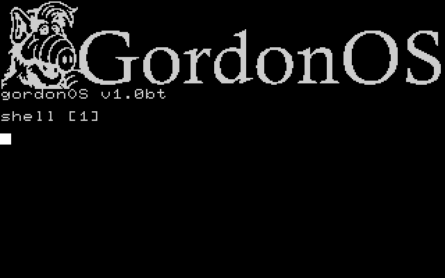
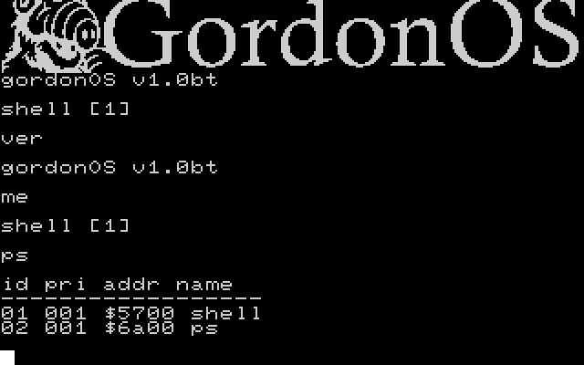
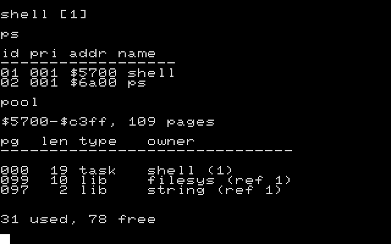
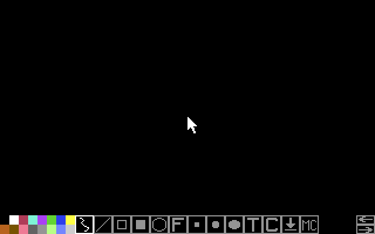
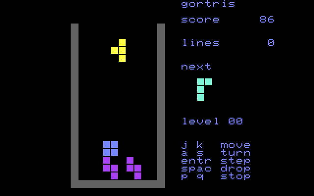
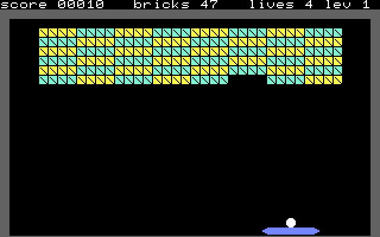
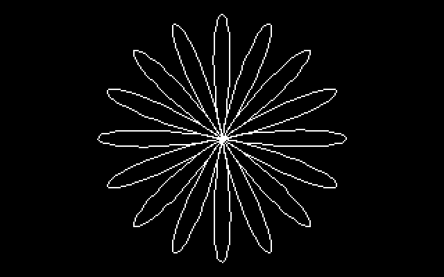
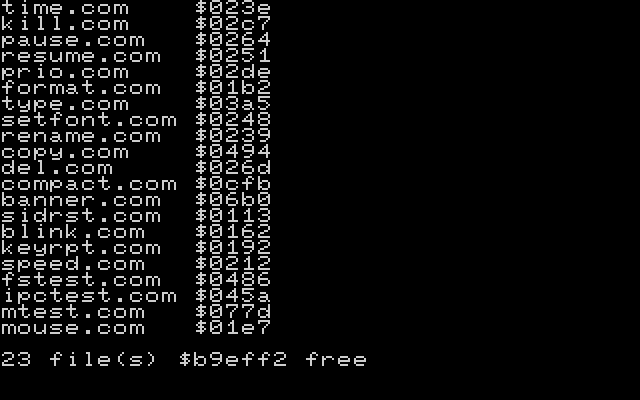
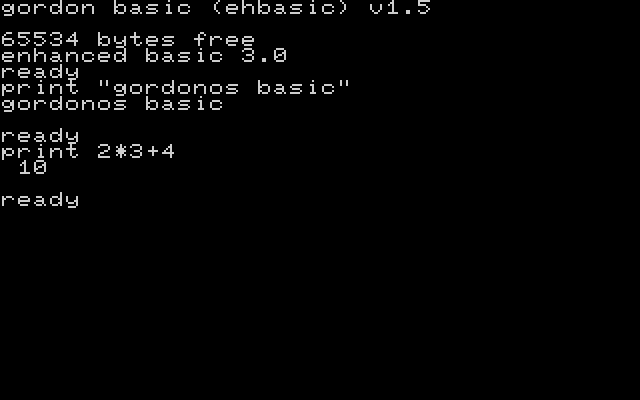
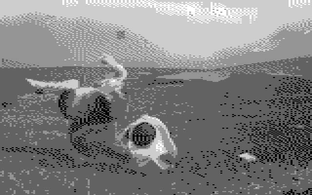

# GordonOS

> Preemptive multitasking kernel for the Commodore 64 with REU — **v1.0 beta**

[](https://github.com/GordonOS/gordon-os/actions/workflows/gates.yml)
[](LICENSE)

GordonOS is a very ambitious from-scratch operating system for C64 hardware with a Commodore REU (RAM Expansion Unit), and it is **a true preemptive multitasking OS**: up to 24 tasks run at once, preempted by a ~60 Hz timer interrupt, each with its own 256-byte stack and a preserved zero page, switched with REU DMA. Both KERNAL and BASIC ROMs are banked out ($01=$35), so the whole 64 KB address space is RAM — shared between the kernel, the display (matrix and framebuffer) and the task pool that task binaries are loaded into — and the hardware vectors at $FFFA-$FFFF are the kernel's own.



*A fresh boot: the banner, `gordonOS v1.0b1`, and the shell's first prompt.*

### Screenshots

Every image is a real capture from VICE at the project's own profile

| | |
|---|---|
|  |  |
| `ver`, `me` and `ps` at the shell | `pool`: 109 pages, with the libraries at the top |
|  |  |
| **GordonPaint**, a new canvas with the band up | the **editor**, status bar and all |
|  |  |
| **gortris**: three pieces landed, one falling | **gorkanoid**: a damaged wall, ball in play |
|  |  |
| **gfxdemo**: a spider-web weave drawn with `kLine` | **spirog**: a hypotrochoid from an integer sine table |
|  |  |
| **sprdemo**: eight sprite balls, per-pixel collision | `dir *.com`: the commands in the image |
|  |  |
| **Gordon Basic** running a line | **granim**: 360 frames at 24 fps out of the REU |

The rest, one per subsystem, sit in the docs they belong to: the `dir` options in
[quick-start.md](docs/quick-start.md), each game in its own guide
([gortris](docs/gortris.md), [grknoid](docs/grknoid.md), [gordonpaint](docs/gordonpaint.md)),
the picture viewers in [pic-format.md](docs/pic-format.md), and the 1351 readout in
[lib-mouse.md](docs/lib-mouse.md).

**Key features currently implemented and working:**

> The full tour — every subsystem, what it offers, and where the detail lives — is
> **[docs/features.md](docs/features.md)**.

- **Preemptive multitasking** — CIA #1 timer interrupts at ~60 Hz, round-robin scheduler with per-task priority (0–5)
- **Dynamic task loader** — `run <name>` loads task binaries from the REU filesystem at runtime (`kDynLoad`): **relocatable** tasks (multi-instance via hi-byte fixup tables), **reentrant** tasks (shared resident code, per-instance data), **re-runnable** tasks (fresh copy per `run`, no `? already running`), and **non-reentrant** tasks (single instance — re-running one gives `? already running`); plus **pool eviction** — when the 27.25KB pool (109 × 256B pages, configurable via `src/kernel/pool.inc`) is full, resident tasks are swapped out to make room and restored automatically when space frees (`run basic` fills the pool, evicting the shell until BASIC exits); `ps` lists them, marking an evicted row `(swp)` and one that shares its code with another instance `(shr)`, and `exit`/`kill` free their pool pages automatically
- **Dynamic kernel libraries** — Shared, refcounted `.lib` binaries loaded on demand into the pool via jump-table vector stubs (eager or lazy). See **[docs/dynamic-libraries.md](docs/dynamic-libraries.md)**
- **Inter-process communication** — `ipc.lib`: four lock-free single-producer / single-consumer **byte channels**, each with a 128-byte ring in the library's own data, so two tasks exchange bytes with no kernel buffer, no new syscall and no caller zero page (`kIpcPost` blocks by yielding while the ring is full, `kIpcPick` returns `C=1` when it is empty). See **[docs/lib-ipc.md](docs/lib-ipc.md)**
- **Gordon Basic (derived from EhBASIC) interpreter** — full floating-point Microsoft BASIC 2.0 compatible, REU-backed persistent working file that provides 64KB of BASIC RAM (`basicwrk`), case-preserving I/O, RUN/STOP support; loaded on demand via `run basic`
- **REU-accelerated context switches** — full 256-byte stack save/restore via DMA (~256 cycles vs ~2048 in software)
- **Per-task virtual screens** — up to 28 independent screen buffers with per-screen cursor, colors, and charset, bitmap-backed text rendering. The VIC-II stays in hires bitmap mode permanently; "text" becomes an 8×8 glyph layer blitted on top of bitmap surfaces. Every screen is a 10KB REU bitmap slot
- **Bitmap graphics** — REU-backed bitmap surfaces (28 slots) in standard hires (320×200) and multicolor (160×200) modes. `gfx.lib` provides the full primitive set (`kPlot`/`kLine`/`kBox`/`kFillBox`/`kCircle`/`kEllipse`/`kFloodFill`/`kGetPixel`/`kClearBitmap`/`kSetGfxColor`/`kFillMatrix`) plus pixel-positioned text (`kGfxChar`/`kGfxString`), all hires- and MC-aware
- **Hardware sprites** — all **8** VIC-II sprites through **`sprite.lib`** (`kSpriteSheet`/`kSpriteFrame`/`kSpritePos`/`kSpriteReg`/`kSpriteCollide`) with the art stored in the REU FS as 64-byte-frame sheets. Tasks write a 39-byte RAM **shadow** and the kernel publishes it to `$D000-$D02E` once per frame in the vertical blank, so nothing can tear from a badly-timed write; collisions come back as frame-latched masks. Each task's sprite state (shadow, sheet records, frame indices) is saved per task and **handed over with the display**, so two sprite tasks coexist. Demos: `run sprdemo` (bouncing balls) and `run godzi` (the ported walker/Godzilla demo). See **[docs/lib-sprite.md](docs/lib-sprite.md)**
- **GordonPaint, and a 1351 mouse** — `mouse.lib` (lib 8) reads the Commodore **1351** through the SID's POT lines behind one dispatching call, and **`grpaint`** is the paint program built on it: a canvas in hires or multicolour, a palette/tool band over the bottom two cell rows, thirteen tools, an undo/redo ring five steps each way, and `<name>.pic` save/load in a documented 10,032-byte format (`grview` is its viewer). Declare the mouse with `mouse 1351`; `mtest` is the readout that settles the protocol on a machine. See **[docs/gordonpaint.md](docs/gordonpaint.md)**, **[docs/pic-format.md](docs/pic-format.md)** and **[docs/lib-mouse.md](docs/lib-mouse.md)**
- **REU video playback (`granim`)** — a full-screen **animation** played out of the REU filesystem: the bundled film is 360 multicolour frames at 24 fps (15 seconds) in 60 chunks of six frames plus a manifest, and `run granim llama` plays it. Each frame is six `kReuReadAt` calls, so no window holds interrupts off for more than ~2,000 bytes, and they run in the beam's own order — matrix and colour RAM before the pixels — so the rewrite stays ahead of the raster and never shows a seam; the film clock steps on the machine's **declared speed**, so the film is the same length in *real* time on a 200% emulator as on a real C64; and the display is checked before every update, so an F-key switch **pauses** the film instead of drawing into the new owner's screen. See **[docs/pic-format.md](docs/pic-format.md)** → *The `.anm` film container*
- **Per-task ZP preservation** — tasks declare a ZP region; scheduler DMAs it to/from REU on every switch (zero overhead for non-declaring tasks)
- **Counting semaphores** — 4 semaphores with yield-based blocking (tasks yield instead of spinning)
- **Thread support** — `threadSpawn` creates child tasks that share the parent's memory space; child names are auto-generated as `parent.N`
- **REU filesystem** — flat named-block storage on the REU: format, save, load, delete, rename, dir commands; multi-bank data region (24KB minimum, up to ~64KB-1); 256-entry root directory; data persists across reboots; task and command binaries are pre-seeded by `tools/build-reu.ps1` (`basic.tsk`, `maze.tsk`, `clock.tsk`, `gfxdemo.tsk`, `fpdemo.tsk`, `spirog.tsk`, `sprdemo.tsk`, `godzi.tsk`, `gortris.tsk`, `grknoid.tsk`, `grpaint.tsk`, `grview.tsk`, `granim.tsk`, `shell.tsk`, `edit.tsk`, `sidplay.tsk`, plus the `.com` commands, the REU fonts, the banner, the sprite sheets, bundled `.mus` songs, and the animation chunks under `assets/anim/`)
- **Generic kernel heap (`kMalloc`/`kFree`)** — page-granular task-owned blocks allocated from the task pool, preserved across pool eviction via per-slot REU shadows (32 KB/slot), freed automatically on `exit`/`kill`; `pool` prints the live pool map
- **Interactive shell** — command dispatch (help, ps, kill, pause, resume, prio, view, run, runbatch, time, clear, exit, print, format, fsinfo, dir, type, save, load, del, rename, copy, setfont, banner, speed, blink, keyrpt, sidrst, compact, pool, ver, me, wait), line-buffered with cursor keys, mid-line editing, backspace, and blinking cursor
- **IRQ-driven keyboard** — 16-byte ring buffer with configurable key repeat, F-key screen switching, blinking cursor
- **14 syscalls** — exit, spawn, kill, yield, pause, resume, setprio, gettid, allocscreen*, freescreen*, semWait, semSignal, threadSpawn, sleep (*inert no-ops — use the `kAllocScreen`/`kFreeScreen` calls)

## Quick Start

### No Build? Just Download

In a hurry? Ready-to-run binaries — the PRG and both REU images — are published in the
[binaries repository](https://github.com/besimatalay/gordon-os-binaries), together with the
guides to the shell and its applications. From this repository, grab the pre-built
`build/gordon-os.prg` and load it in VICE (**3.9 or later**, with REU support):

```bash
x64sc -autostartprgmode 1 -speed 200 -reu -reusize 16384 -reuimage /absolute/path/to/reu/REU.bin -reuimagerw build/gordon-os.prg
```

`-speed 200` runs VICE at **200% of real time**, which is what `reu/REU.bin` is built
for — **on a C64 Ultimate, use `reu/REU-C64U.bin` instead**, the same image built for a
machine whose turbo leaves the SID's clock and the video timing alone, so it needs no
speed setting at all. The OS takes the machine's speed from one runtime setting —
**`speed <percent>`**,
declared at boot by a line in `src/batch/boot.bat` — and everything that depends on it
is derived from that:

- the kernel's **cursor blink** (30 ticks = ~500 ms at 100%) and **key repeat**
  (30 ticks before the first repeat, then 6) are scaled to it, so a 200% machine runs
  60/60 12;
- **sid.lib** shifts a tune's pitch by the machine's clock and scales its tempo, so
  music sounds the same in real time on any machine, whatever the caller asks for; the
  **video standard** is measured from the VIC rather than declared, so a PAL machine reads
  its own copy of the note table and is in tune with nothing set;
- **`REU-C64U.bin`** is the same image built with `speed 100`, for a C64 Ultimate: its
  turbo raises the CPU speed without moving the SID's clock or the video timing, so a
  real machine must not be told 200%.

Change it live with `speed` at the shell; `blink <n>` and `keyrpt <delay> <repeat>`
still override the timings afterwards. Mind the direction: **a higher speed needs MORE
ticks**, because each tick is shorter in real time (60/60 12 at 200%, 120/120 24 at
400%). See
[quick-start.md → VICE speed, and the blink / repeat timings](docs/quick-start.md).

> **What a speed change moves, and what absorbs it.** `-speed` runs the whole emulated
> machine faster or slower, so anything measured against the *host*'s clock moves with it:
> the keyboard repeat and the blink above, the perceived pace of a game (its rules are
> emulated-time, so it stays self-consistent, but the player feels the ratio), any task whose
> output is time-sensitive (the `clock` task is the one already documented), and **the SID's
> pitch** — a voice's output frequency is its register value scaled by the CPU clock, so at
> `-speed 200` every note is an octave higher. The keyboard timings and the music are now
> **derived from `speed`** — the tick counts by `speed.com`, the pitch and the tempo by
> sid.lib — so neither a game's music nor the keyboard needs per-task tuning. A game's own
> pace (how fast its ball moves) is the game's business, not the system's.
>
> **On a C64 Ultimate, none of it applies.** The Ultimate's turbo is a *CPU* setting — its
> manual calls it **CPU speed** (up to 48x, 64x on an Elite-II) and describes it as giving the
> CPU more time slots of the fast system clock, while the VIC keeps priority and anything that
> leaves the board, the SID sockets included, still runs at 1 MHz. The SID is therefore
> clocked exactly as it is at 1x: **its pitch does not change**, the video timing stays
> standard (so the blink and the key repeat are in real time as written), and nothing needs
> transposing or rescaling. It is emulation `-speed` — not turbo — that moves the pitch, which
> is why that machine gets an image with `speed 100`.

**REU is required.** In VICE: Settings → Cartridges → RAM Expansion Module → 16384K or larger.

`-reuimagerw` writes the REU image back to disk on exit, so files you `save`
persist across sessions.

> Dragging `build/gordon-os.prg` into the VICE window alone is **not**
> enough: attach the REU image first (Settings → Cartridges → RAM Expansion
> Module → Browse → `reu/REU.bin`) and check **"Write image on detach/emulator
> exit"** there if you want saved files to persist.

**REU image file:** `reu/REU.bin` — pre-initialized REU content (char shadows, ZP shadows, color RAM, and the REU filesystem with task binaries). Load via VICE: Settings → Cartridges → RAM Expansion Module → Browse → select `reu/REU.bin`. Task and command binaries are pre-seeded by `tools/build-reu.ps1`. Saved files persist across reboots.

### Build from Source

1. **Clone the repository and open it in VS Code once**, so the VS64 extension
   generates `build/build.ninja` (it is gitignored; without it the kernel build
   stops with `Missing build/build.ninja`):

   ```bash
   git clone https://github.com/GordonOS/gordon-os.git
   cd gordon-os
   ```
2. **Create your settings file** (once per machine — it is gitignored):
   `cp .vscode/settings.json.sample .vscode/settings.json` (Linux/macOS) or
   `Copy-Item .vscode\settings.json.sample .vscode\settings.json` (Windows),
   then edit the four `vs64.*` paths in it (KickAssembler dir, Java, Ninja, VICE).
   Without it the build stops with `KickAss.jar not found at:`.
3. Build:

   ```bash
   pwsh -NoProfile -File tools/build-kernel.ps1                                 # Linux/macOS
   powershell -NoProfile -ExecutionPolicy Bypass -File tools/build-kernel.ps1   # Windows
   ```

Output: `build/gordon-os.prg` — drag into VICE or load with `LOAD"*",8,1`. For a
full tree, run `tools/build-tasks.ps1` (tasks and libraries into `tasks-out/`)
and then `tools/build-reu.ps1` (seeds both REU images); both take the same
command form. In VS Code, pick **Build & Launch with REU** (kernel only, existing REU, with `reu/REU-C64U.bin` refreshed) or **Build & Launch with fresh REU** (rebuilds tasks + seeds a fresh REU) from the Run and Debug view, then press **F5**.

Full setup instructions in **[docs/quick-start.md](docs/quick-start.md)**; the toolchain,
the build stages and the gates are in **[docs/development.md](docs/development.md)**.

### Run on a C64 Ultimate / Ultimate 64

The same `REU.bin` image works on real hardware via the built-in 16 MB REU of
the Ultimate-II+ cartridge or an Ultimate 64 board. The REU image is a raw
16,777,216-byte memory dump, and the Ultimate accepts any filename or
extension, so `REU.bin` works as-is.

1. Copy `build/gordon-os.prg` and `reu/REU.bin` to a FAT32 USB flash drive and
   insert it.
2. Boot into the Ultimate menu (middle button on the Ultimate-II+; the menu
   button on an Ultimate 64).
3. Press **F2**, open **C64 and Cartridge Settings**, and enable the
   **RAM Expansion Unit (REU)** with a size of **16 MB**.

Then load the REU image using either method:

- **Manual on-demand load:** in the file browser, highlight `REU.bin`, press
  **Return**, and choose **Load into REU**.
- **Persistent boot preload:** in settings, set **REU Preload Image** to
  `REU.bin` on the USB drive (e.g. `/Usb0/REU.bin`) and set **REU Preload** to
  **Enabled**.

Finally, return to the file browser, select `gordon-os.prg`, press **Return**
and choose **Run** (DMA load) to start GordonOS.

#### Persistence

The Ultimate does not automatically write the REU contents back to USB. Any
changes GordonOS makes (for example files you `save`) live in REU memory only
until you export them. Before powering down:

1. Press the **Menu** button to interrupt the C64.
2. Press **F5** to open the Command/Action menu.
3. Navigate to **C64 Machine**.
4. Select **Save REU Memory**.
5. Enter a filename (e.g. `REU.bin` to overwrite the image) and press Enter to
   write the raw 16 MB block back to the USB drive.

## GordonPaint and the 1351 mouse

**`grpaint`** — the paint program, `run grpaint <name>` — is drawn with a Commodore **1351**
mouse and refuses to start without one: it prints `? mouse off - run 'mouse 1351'` and waits for
a key. Both target machines can present a 1351, and each needs one thing told to it.
The program itself — the band, the thirteen tiles, the palette and the undo ring — is
[docs/gordonpaint.md](docs/gordonpaint.md).

**Under VICE, the 1351 is two flags, not one** — the control-port device *and* the
host-pointer grab:

```bash
x64sc -autostartprgmode 1 -speed 200 -reu -reusize 16384 -reuimage /absolute/path/to/REU.bin -reuimagerw \
      -controlport2device 1351 -mouse build/gordon-os.prg
```

The device alone is not enough: without `-mouse` VICE never feeds the host pointer in, so the
POT bytes stay frozen and the buttons read released. In the GUI that is *Control port settings*
→ control port 2 → **Mouse (1351)**, plus VICE's mouse-grab setting. Attach it **before** the
machine starts — attaching a mouse afterwards needs a reset. `tools/launch-vice.ps1 -Mouse1351`
adds both flags, and so do the two **Build & Launch with REU (1351 mouse)** F5 flows; the other
F5 flows leave port 2 to the joystick. While VICE runs, **Alt-M** toggles the mouse grab on and
off (`Command-M` on macOS — VICE's `mouse-grab-toggle` hotkey), which is how to get the host
pointer back without quitting.

**On a C64 Ultimate**, plug a real 1351 into **control port 2**: it is a joystick-port device and
the board handles its POT lines itself, so a real 1351 needs nothing enabled for it — and if
the mouse has to live in port 1, an Ultimate 64 Elite can swap the two ports from the menu with
**C= + J**. **A USB mouse works just as well**, because the machine can act as the 1351 itself:
its mouse options include *Cursor*, *Mouse*, *Mouse+Cursor* and *Mouse+Wheel* modes, with
sensitivity and adaptive acceleration, and firmware 3.15 reads each mouse by its HID report
descriptor instead of assuming boot protocol — which is what makes most USB mice work. Either
way, declare it at the shell, `mouse 1351`; the shipped image's `boot.bat` already does that at
boot.

---

## Prerequisites

| Tool | Version | Purpose |
|---|---|---|
| [VS Code](https://code.visualstudio.com/) + [VS64](https://marketplace.visualstudio.com/items?itemName=rosc.vs64) | Latest | IDE with KickAssembler + Ninja + VICE integration |
| [Git](https://git-scm.com/) | any | cloning the repository |
| [Java JDK](https://adoptium.net) | 8+ (tested with 26) | Required by KickAssembler |
| [KickAssembler](http://www.theweb.dk/KickAssembler/) | v5.25 | 6502 assembler |
| [VICE](https://vice-emu.sourceforge.io) | 3.9+ (GTK3) | C64 emulator with REU support |
| [Python](https://www.python.org/) | 3.9+ | The generator and publish tools: `gen-corpus.py`, `gen-mus.py`, `gen-sprites.py`, `gen-ui.py`, `img2bnr.py`, `img2pic.py`, `gen-anim.py`, `scan-history.py`, `publish.py` |
| Pillow | any current | Python imaging, for `img2pic.py` / `img2bnr.py` / `gen-anim.py` |
| An FFmpeg | any current | Extracting an animation's frames — **only** for the film workflow, never for the build. Easiest is `pip install imageio-ffmpeg`, which vendors one |
| Ninja | Included with VS64 | Build system |

The Python tools run from a virtualenv in the repo root (`.venv`, gitignored):
`python -m venv .venv` on Windows, `python3 -m venv .venv` on Linux/macOS, once,
then activate it and install their packages:

```bash
python -m pip install Pillow imageio-ffmpeg py65
```

`imageio-ffmpeg` is the recommended FFmpeg because it **vendors a static binary** — no
system install, no `PATH` edit, no administrator prompt. `py65` is needed only by
`dis6502-linear.py`, the disassembler cross-check; the generators and the build do
not import it. On a machine that already has
one, `winget install Gyan.FFmpeg` / `brew install ffmpeg` / `sudo apt install ffmpeg`
works just as well.

Per-OS install commands for every tool above — including **PowerShell 7**, which
the build scripts need on Linux/macOS — are in
**[docs/quick-start.md](docs/quick-start.md)** → *Option 2: Build from source* →
*Prerequisites*.

The whole environment — what each tool is for, the three build stages, the files that
configure them and the gates that fail the build — is
**[docs/development.md](docs/development.md)**.

**VS Code extensions.** The repo ships `.vscode/extensions.json`, so VS Code
offers these the first time you open the folder (Extensions view →
*Recommended*):

| Extension | Why |
|---|---|
| `rosc.vs64` | **Required** — the C64 development environment: KickAssembler + Ninja + VICE integration, and the source of the `vs64.*` tool paths below. It supplies the build task and the F5 launch flows |
| `captainjinx.kickass-c64` | KickAssembler syntax highlighting for `.asm`/`.inc` (the sources) |
| `ms-vscode.powershell` | Optional — for editing the `tools/*.ps1` build and launch scripts |

> **⚠️ Tool paths live in `.vscode/settings.json`, which is gitignored** — the
> locations are machine-specific, so a fresh clone does not have one and the
> first build stops with `KickAss.jar not found at:` (an *empty* path — that
> means the settings file is missing, not the assembler). Create it from the
> bundled sample and edit the four paths:
>
> ```bash
> cp .vscode/settings.json.sample .vscode/settings.json           # Linux/macOS
> ```
> ```powershell
> Copy-Item .vscode\settings.json.sample .vscode\settings.json    # Windows
> ```
>
> `.vscode/settings.json` is the single source of truth for the build and
> launch scripts (`tools/toolpaths.ps1` reads it, and the VS64 extension reads
> the same keys). `VICE_EXE` / `KICKASS_JAR` / `JAVA_EXE` / `NINJA_EXE` env vars
> override it for ad-hoc runs. Full setup: [docs/quick-start.md](docs/quick-start.md) →
> *Option 2: Build from source*.

### VICE REU Setup (required)

GordonOS **requires** a RAM Expansion Unit. Boot halts with 'REU required' if none is detected.

1. **Settings > Cartridges > RAM Expansion Module**
2. Set to **16384K** for best results (GordonOS uses several REU banks for stack/ZP/color shadows, bitmap slots, and the filesystem — the FS requires ≥6 banks / 384KB)
3. Check **Save settings on exit**

---

## What You Can Do

### Shell Commands

All task management commands use numeric IDs (shown by `ps`).

```
help                       List all commands
ver                        Show OS name + version (gordonOS v1.0bt)
me                         Show your own task ID, priority and name
wait                       Print "press any key to continue..." and wait
print <text>               Print text to the shell
ps                         Show running tasks (id, pri, pool address, name,
                           plus (swp)/(shr)/(pau)/(slp) markers)
run <name> [args]          Load + spawn a task binary from REU (e.g. run basic)
runbatch <file>            Run a .bat batch script from the REU filesystem
pool                       Show the task-pool map (pages, owners, sizes)
kill <id>                  Terminate a task (cascades to thread-spawned
                           children). A task that declared sid.lib — or whose
                           spawner did — has the SID silenced too, so a killed
                           music task cannot leave the chip droning
pause <id>                 Suspend a task
resume <id>                Resume a paused task
prio <id> <0-5>            Set scheduling priority (0 = paused)
time                       Show current time
time hhmmss [am|pm]        Set the clock
clear                      Clear the screen
view <id>                  Switch display to a task's screen
exit                       Exit the shell

--- REU Filesystem ---
format                     Format the REU filesystem (y/n confirm)
fsinfo                     Show FS status (banks, free space)
save <name> <start> <end>  Save C64 memory block to REU (hex addresses)
load <name> <addr>         Load named file from REU to C64 address
del <pattern>              Delete files matching a wildcard pattern from REU
                           (* = any run, ? = any single char)
compact                    Pack the FS and reclaim tombstoned slots
rename <old> <new>         Rename a file in REU
copy <src> <dst>           Copy a file to a new name in REU
dir [/w|/p] [pattern]      List files with sizes + free space; /w = two columns,
                           /p = pause every 24 lines, pattern = wildcard
                           filter (* = any run, ? = any single char)
type <file>                Print a file's contents to the shell
setfont <name>             Load <name>.fnt from REU into the font buffer
banner <file> <row> <col>  Draw a .bnr custom-glyph banner (c×r glyphs)
sidrst                     Reset the SID (zero all SID registers) — the manual
                           fallback for a stuck note (kill clears one itself
                           for a task that declared sid.lib)
 speed <percent>            Declare the machine's whole-clock speed: 100 =
                            real time, 200 = what VICE runs at here. Scales the
                            kernel's blink/repeat ticks and sid.lib's music
                            compensation, so the keyboard and the music suit the
                            machine. Powers of two only (25 50 100 200 400 800),
                            because the pitch correction is a whole octave per
                            step. Declared at boot by the image's boot.bat.
                            Silent on success; anything else (including no
                            argument) prints the accepted values. The images
                            declare 100 (C64 Ultimate) and 200 (VICE).
                            Faster than 200% applies to the emulator only,
                            and is not recommended: the SID would need more
                            than one octave down
 blink <n>                  Set cursor blink interval to n ticks (default 30,
                            ~500ms at 100%; higher = slower blink). `speed`
                            re-derives it for the machine, so run `speed` first
 keyrpt <delay> <repeat>    Set keyboard repeat timing: delay ticks before
                            the first repeat, then repeat ticks between
                            (defaults 30/6 = ~500/~100ms at 100%; min 1). Also
                            re-derived by `speed` — see docs/quick-start.md
 mouse [1351|off]           Declare the machine's pointer device (the kernel's
                            mouseKind byte): `mouse 1351` or `mouse off` sets
                            it, bare `mouse` prints it. Policy only — no
                            hardware. boot.bat declares 1351 at boot
 mtest                      The 1351 readout, for settling the protocol on a
                            machine: raw POT byte, position mod 64, the delta
                            since the last sample, the running total and the
                            six $DC00 button lines. `p` switches port, `h`
                            cycles the hold, `l` reads the hardware directly or
                            through mouse.lib, any other key exits
 fstest                     REU-FS self-test across the bank boundary
 ipctest                    ipc.lib channel self-test (prints `ipc PASS`)
```

**Screen switching:** F1→screen 0, Shift+F1→1, F3→2, Shift+F3→3, F5→4, Shift+F5→5, F7→6, Shift+F7→7 (MAX_SCREENS=8).

### Available Tasks

| Task | How | Description |
|---|---|---|
| shell | `run shell` | Interactive console (running at boot) |
| basic | `run basic` | Gordon Basic (based on EhBASIC v2.22p5 interpreter) (REU-backed working file) |
| edit | `run edit [file]` | Full-screen 25×40 text editor — insert/overwrite modes, two-way scrolling, document grows on demand (up to 192 lines), saves back to the same file; `STOP+M` marks a selection, `STOP+Y`/`K`/`P` copy, cut and paste it. Full reference: **[docs/edit.md](docs/edit.md)** |
| maze | `run maze` | Animated maze renderer (relocatable, bundled) |
| clock | `run clock` | CIA TOD clock at (0,0) on the shared screen (relocatable, bundled). It only *displays* the TOD, so set the time first with `time hh:mm[:ss] [am|pm]`; accurate only at 100% emulation speed, and it loses time under REU load — see **[docs/lib-time.md](docs/lib-time.md)** |
| gfxdemo | `run gfxdemo [step]` | Spider-web line weave demo — `step` = line interval 1–25 (relocatable, bundled) |
| fpdemo | `run fpdemo` | `fp.lib` showcase — sine wave edge-to-edge with a cosine superimposed, plotted pixel-by-pixel (relocatable, bundled) |
| spirog | `run spirog [R r d col \| 1-9 \| 10]` | Integer spirograph — a hypotrochoid traced as a `kLine` polyline from a 256-entry sine table (no floating point), so it closes exactly. `R` ring radius, `r` rolling radius (`R` > `r`), `d` pen offset, `col` 1–15; values over 127 are clamped and the figure is scaled to fit. No arguments draws an 80/35/45 rosette, `1`–`9` picks a preset sized to the full screen height, and `10` uses **multicolour** to draw 25 random presets. `q` exits; **re-runnable** (relocatable, bundled) |
| sidplay | `run sidplay <name> [delay] [repeats]` | Plays a COMPUTE!'s Enhanced Sidplayer `.mus` song (`commodo`, `fsonata` bundled) through **sid.lib** — single-instance, no screen; `delay` = ticks per jiffy (default 1, raise it to slow down), `repeats` = `0` forever / `1` once (default) / N plays. A failure prints `? tune <name>` / `? load <name>` / `? no memory` / `? no player` on a temporary screen and waits for a key, instead of exiting silently |
| sprdemo | `run sprdemo` | The sprite subsystem's demo: eight coloured balls bouncing off the walls and off each other, one update per displayed frame. `q` exits. Its only asset is the sprite sheet `ball.spr` (relocatable, bundled). **Re-runnable**, and it may run alongside any other sprite task: the kernel keeps one task's sprite state live and swaps it with the display |
| godzi | `run godzi [1\|2]` | **Pinned (`KF_NOT_EVICTABLE`)** — pool eviction never swaps it out. A port of the stand-alone demo in `reference/godzi.asm`/`reference/main.asm`: a boat-shaped walker crosses the screen while a "Godzilla" flaps between two poses. Four sprite slots - The walker's two overlapping layers plus the two Godzilla poses — art in `boat.spr`/`godzi.spr`, X-expanded walker (black rigging over a light-blue hull), one update per displayed frame. Its music is its own (`sid.lib` called directly from a thread child, as `gortris` does): it loads `commodo` for mode 1 and `fsonata` for mode 2 at startup and the child plays the selected one, so `1`/`2` switches the song with the look — no re-load, no gap — and `q` hushes the SID, reaps the child and frees both buffers, leaving nothing playing. `1`/`2` switch between the two looks live, `q` exits. Killing it from the shell does not run that path, so `sidrst` is needed to silence the chip. It is relocatable and **single-instance for the SID** — it holds the chip for its whole life, so a second `run godzi` is refused (`? already running`) — while the sprite side needs no guard at all: the per-task sprite state is swapped with the display. It is bundled |
| gortris | `run gortris` | **Tetris** — the game logic of Wiebo de Wit's `tetris.c64` (MIT license) ported to GordonOS: the piece set, the frame-range rotations, the move-then-test order and the line sweep are its, while the artwork is ours (drawn with the kernel's glyph support, because the original was char-mode and GordonOS is all-bitmap). The 10×20 board lives in the task image, so collision is a board lookup instead of a screen read. Five modes: attract (four screens), level select (levels 0–9 on the original's own grid — `j`/`k` or a digit to choose, ENTER to start, with the hi-score table shown here), play, and the original's game-over animation (the well fills a row a frame, is held full ~3 s, empties, then `game over` / `press key` print inside it). The keys are the original's bar the move pair — `j` `k` move, `a` `s` turn, ENTER soft drop, `p` pause — plus SPACE (hard drop) and `q` (exit); the port-2 joystick works too (UP rotate CCW, DOWN soft drop, LEFT/RIGHT move, FIRE rotate CW, and FIRE starts a game). 10 lines per level, the fall delay drops by 4 per level (floored at 4), a line scores × (level+1), and the level you chose is remembered for the next game. Three hi scores (7-character names) live in the REU FS as `gortris.hi`, typed in on the game-over screen under the kernel's blinking block cursor. The music is `music/tetris.mus`, loaded by the task itself and played through **sid.lib** from a thread child it spawns — not through `sidplay.tsk` — and hushed when the display is lost — the tune is a single pass, so the repetition is the *player's* (`kSidPlay` repeats 0), which is also why `run sidplay tetris` plays it once and stops. `m` mutes it from any screen — the panel says `music off` — and the mute survives losing and regaining the display. **Not re-runnable** (a second `run gortris` gets `? already running`) and pinned in the pool (`KF_NOT_EVICTABLE`), because it owns the display and holds the board (relocatable, bundled). Full reference: **[docs/gortris.md](docs/gortris.md)** |
| grknoid | `run grknoid` | **Gorkanoid** — an Arkanoid/Breakout game: a paddle sprite (X-expanded 24→48px) under a wall of glyph bricks, with a ball flown in 8.8 fixed point.The wall is a 48-entry byte array in the task image (0 = a gap, 1-3 = the hits to break the brick) and is the **authority** — the drawn cells are presentation, and nothing reads the surface back. The paddle follows the *held* key (`keybHeld` is a level, so `kReadKey`'s event cadence is wrong for it) one step per displayed frame, and that step **accelerates**: it starts at 1 px and gains a gear every 16 frames the *same* direction is held, up to 3 px, dropped straight back by a release or a reversal — so placing the paddle is precise and chasing the ball with it is fast. Keys: `j` `k` move, SPACE serves, `p` pauses, `q` exits; the port-2 joystick drives the same bits (and **has not been played-tested** — the dev setup has no stick). The bounce angle comes from where the ball met the paddle, floored so it can never climb straight up, plus english from the paddle's own movement (a paddle held against a wall contributes nothing); five lives, a per-level launch ramp (level 5 launches at twice level 1), a colour pulse on the ball, and `score`/`bricks`/`lives`/`lev` on the HUD. Four attract screens (title, controls, credits, high scores), and a game-over screen whose tune is its clock: the screen waits for `firstdt` to finish and leaves when it does — or at once on a key. Three hi scores (7-character names) live in the REU FS as `grknoid.hi`, typed in under the kernel's blinking block cursor. Its music is three **Compute's Gazette Sid Collection** tunes (`katmand`, `immig`, `firstdt`) played through **sid.lib** by a thread child it spawns, one per mode, out of **one buffer for the session** — an 18-page `kMalloc` taken at startup (the largest tune's size) and freed on the way out after the child has been reaped, so a mode change makes no pool request at all. A SID another task is holding is retried, and a tune that will not load (missing, or longer than the buffer) falls back to the attract tune instead of blocking the game. **Not re-runnable** (a second `run grknoid` gets `? already running`) and **pinned** in the pool (`KF_NOT_EVICTABLE`), because it owns the display for its whole life and holds the wall and the score table (relocatable, bundled). Full reference: **[docs/grknoid.md](docs/grknoid.md)** |
| grpaint | `run grpaint <name> [colours…]` | **GordonPaint** — the **1351 paint program**, and the reason `mouse.lib` exists. `run grpaint shot` opens `shot.pic` (a picture that is there is loaded, one that is not is the blank canvas), and the rest of the command line sets the colours a NEW picture starts in — their **count** is the mode: three values for hires (`run grpaint shot 1 1 0` = border 1, paper 1, ink 0), five for multicolour (`1 1 2 7 15` = border, background, c1, c2, c3); an existing picture's own mode and colours win. The canvas is the whole screen and the UI band sits over its bottom two cell rows — **a right press anywhere toggles it**, a left press takes an entry and leaves it up, a left press off the entries closes it. Sixteen palette swatches (in hires the first is the **eraser**: the drawing calls read colour 0 as *clear*), thirteen tiles (pencil, line, box, filled box, circle, flood fill, three brushes, text, clear, save, MODE) plus the four multicolour slot chips. **Undo and redo are five steps each way** — `u`/`r` or the band's two stacked arrows, white while they have a step to take — and the line's first click only anchors, so it is not a step. `q` leaves at once on a clean canvas and otherwise asks first, flashing the SAVE tile. It needs `mouse 1351` (see **GordonPaint and the 1351 mouse**); **single-instance** and pinned, because its live footprint is 71 of the pool's 109 pages. Saves the documented `.pic` format — see **[docs/pic-format.md](docs/pic-format.md)**; full program reference: **[docs/gordonpaint.md](docs/gordonpaint.md)** |
| grview | `run grview <name>` | Picture viewer for the `.pic` format (`run grview hires` opens `hires.pic`): it allocates a bitmap surface, takes the display and DMAs the file's three regions straight to `$2000`/`$0400`/`$D800`, with the mode and all four VIC colours from the file's own header. `m` reinterprets the same bytes in the other mode (nothing is converted) and any other key exits. `hires.pic`, `mc.pic`, `alf.pic` and `alfgs.pic` ship as samples — the last two the same photograph as a multicolour conversion, in colour and in the three greys |
| granim | `run granim <film>` | **GordonAnim** — a full-screen animation player for the REU filesystem's `.anm` chunks. `run granim llama` plays the bundled film: 360 multicolour frames at 24 fps, 15 seconds, shipped as 60 chunks of six frames plus a manifest (`assets/anim/llama/`). Each frame is six `kReuReadAt` calls, so no window holds interrupts off for more than ~2,000 bytes; the film clock steps on the machine's **declared speed**, so the film is the same length in real time on a 200% emulator as on a real C64; and the display is checked before every update, so an F-key switch **pauses** the film rather than drawing into the new owner's screen. `+`/`-` change the rate (a quarter speed to double, default is the film's own), SPACE pauses, `q` exits. The bundled film is a greyscale conversion of *Caminandes 1: Llama Drama* — credit in [NOTICE](NOTICE); the container is [docs/pic-format.md](docs/pic-format.md) |

The dynamic task sources live in `src/tasks/dynamic/` (v2 format); the original code they import (`.inc` files) lives in the same folder, next to the wrappers. See the [programmers guide](docs/programmers-guide.md) for how to write or migrate a task.

`run` starts a long-running **task** binary (`.tsk`). The shell's utility words — `ps`, `dir`, `time`, `kill`, `pause`, `resume`, `prio`, `format`, `type`, `setfont`, `rename`, `copy`, `del`, `banner`, `sidrst`, `speed`, `blink`, `keyrpt` — are separate **command** binaries (`.com`) that the shell loads and runs to completion before returning to the prompt. See the [programmers guide](docs/programmers-guide.md).

### Gordon BASIC

```
run basic
```

Launches a full Microsoft BASIC 2.0 compatible interpreter on its own screen. `run basic` opens or creates the persistent REU-backed working file (`basicwrk`). Features:
- **Floating-point math** — print 2+3*4 -> 14
- **REU-backed working file** — program text, variables, arrays, and strings persist in the working file
- **Case-preserving I/O** — shifted letters are uppercase, unshifted are lowercase
- **RUN/STOP -> break** — stops a running program
- **DEL -> backspace** — delete characters during line input
- **All standard BASIC commands** — for/next, gosub/return, if/then/else, dim, read/data, string functions, trig, etc.
- **Filesystem commands** — `dir` lists the REU FS; `save "name"` / `load "name"` store programs as `name.bas`
- **Bitmap graphics commands** — `mode`, `pen0`–`pen3`, `cls`, `plot`, `line`, `box`, `fillbox`, `circle`, `ellipse`, `flood`, `gchar`, `gtext`, `printat`, `locate`, `colour`, `border`, `scroll`, `scrollby`, `shadow`, `gdef`, `glyph`, and `getpixel()` (hires 320×200 + multicolor 160×200)

Full language reference: **[docs/gordonbasic.md](docs/gordonbasic.md)**.

`run basic` fills the pool, so the loader **evicts the shell and other resident tasks** to make room and restores them when BASIC exits (evicted tasks cold-restart, losing scrollback/program state). A task with thread children is killed instead of swapped.

Because the pool hands out **contiguous** pages, repeated `run`/`exit` of differently-sized tasks can leave the free space split — `? no space in pool` can then appear even though `pool` reports plenty of free pages (compare its `pg` column with a fresh boot). This is an accepted limitation: **[docs/programmers-guide.md](docs/programmers-guide.md) § Pool fragmentation**.

### REU Filesystem

`format` initializes a flat filesystem on the REU. Files are named blocks of C64 memory saved to/persisted from REU.

```
format                     → format? y/n → y → formatted
save hello 0400 0500       → saved $0100
save world 0600 0700       → saved $0100
dir                        → hello  $0100
                              world  $0100
                              2 file(s) $5E00 free
load hello 0800            → loaded $0100
del world                  → deleted
```

- **Multi-bank data region** — 24KB in bank 5 plus 64KB per additional bank (16-bit capacity, up to ~64KB-1); 256-entry root directory
- **Data persists** across reboots — files survive `exit` + restart
- **Deletion** marks entries deleted; `compact` reclaims the space
- See [docs/kernel.md](docs/kernel.md) for the kernel call API

---

## Architecture

GordonOS is a preemptive multitasking kernel: round-robin scheduler at ~60 Hz, full 256-byte stack + optional ZP region context-swapped via REU DMA, 24 task slots, 28 REU-evacuable screen buffers, bitmap graphics, 14 syscalls, an EhBASIC interpreter loaded on demand, and a dynamic task loader that pulls binaries from the REU filesystem.

→ Full details: **[docs/architecture.md](docs/architecture.md)**

---

## Memory Map

The kernel banks out both ROMs ($01=$35) for full 64KB RAM control. The `$2000-$3FFF` range doubles as the bitmap DMA area — screens survive via REU evacuation. Scratch buffer at `$C400`; kernel code and the jump table from `$E000`; the dynamic loader band is `$4310-$5336`, followed by `font-help.inc` (`$5340`), `pool-top.inc` (`$53F2`, library pool placement) and `scrollScreenSlot` (`$54AB`); the task pool is `$5700-$C3FF` (109 × 256B pages, configurable) where relocatable task code **grows up from the bottom** and `.lib` libraries **come down from the top**. `run basic` evicts resident tasks (and frees their libraries) to fit, restoring them on exit.

→ Full address space: **[docs/memory-map.md](docs/memory-map.md)**

---

## Syscalls

| # | Name | Input | Output | Description |
|---|---|---|---|---|
| 0 | exit | — | — | Terminate current task |
| 1 | spawn | spawnPtr = task addr, kArg+6/+7 = ZP base/len | A = child slot | Spawn a new task |
| 2 | kill | X = target task ID | — | Kill task by ID (cascades to children) |
| 3 | yield | — | — | Voluntarily yield timeslice |
| 4 | pause | X = target task ID | — | Suspend a task |
| 5 | resume | X = target task ID | — | Resume a paused task |
| 6 | setprio | X = task ID, kArg = priority (0–5) | — | Set scheduling priority |
| 7 | gettid | — | A = own task ID | Get current task's ID |
| 8 | allocscreen | A = charset (0=lowercase, non-zero=uppercase) | C=1 on failure | Allocate private screen buffer |
| 9 | freescreen | — | — | Release allocated screen |
| 10 | semWait | X = semaphore # (0–3) | — | Wait (yield) on semaphore |
| 11 | semSignal | X = semaphore # (0–3) | — | Signal semaphore |
| 12 | threadSpawn | spawnPtr = thread addr | A = child slot | Spawn thread (shared parent context) |
| 13 | sleep | kArg+1 = tick count (1-255) | — | Timed block; resumes after N ticks |

Invoke via: lda #<n>; ldx #<arg>; jsr syscall (see [docs/programmers-guide.md](docs/programmers-guide.md)).

---

## Source Layout

```
gordon-os/
├── build/                 Build output (gordon-os.prg, .dbg, .info, main.sym, build.ninja)
├── charsets/              PET/C64 font sources (gordon.fnt, c64low.fnt, c64uppr.fnt, chargen ROMs)
├── assets/sprites/        Sprite sheet sources: *.txt (ASCII art, the source of
│                          truth) next to the *.spr the VIC reads; add a sheet to
│                          the $assets array in tools/build-reu.ps1 to ship it
├── assets/ui/             UI band sources: gpui.txt (ASCII-art tool pictures, the
│                          source of truth) next to the gpui.bin and gpui_mc.bin
│                          that grpaint reads into its palette band (one file per
│                          mode); shipped by the same $assets array
├── assets/pics/           Picture samples: hires.pic, mc.pic, alf.pic and
│                          alfgs.pic (a photograph, colour and greyscale) -- the
│                          .pic format, docs/pic-format.md -- shipped by the same
│                          $assets array, next to the PNGs tools/img2pic.py writes
│                          them from (a source named *-mc-src.png is multicolour,
│                          *-dither45-src.png is error-diffused at 45%) and
│                          alfpic.png, the photograph the two ALF sources were cut
│                          from and graded
├── assets/anim/           Animation films: one folder per film, holding its chunks
│                          (*.anm, each a run of whole 10032-byte .pic records) and
│                          its manifest (*.inf) -- the .anm container is
│                          docs/pic-format.md, and the seeder globs *.anm/*.inf
│                          here. llama/ is the bundled 360-frame film:
│                          `run granim llama`
├── music/                 COMPUTE!'s Enhanced Sidplayer tunes (*.mus, seeded raw
│                          into the REU FS: commodo, fsonata and tetris, plus
│                          grknoid's katmand, immig and firstdt)
├── docs/                  Design docs -- the Documentation table below indexes
│                          them: guides (quick-start.md, tutorial.md,
│                          architecture.md, development.md, programmers-guide.md,
│                          writing-relocatable-tasks.md, dynamic-libraries.md),
│                          references (kernel.md, syscall.md, memory-map.md,
│                          kernel-fragmentation.md, kernel-to-lib-survey.md,
│                          pic-format.md, c64_1750_REU_programming_guide.md and the
│                          lib-*.md call references), the call inventories
│                          (kernel-call-inventory.md, library-call-inventory.md),
│                          application guides (gordonbasic.md, edit.md,
│                          gordonpaint.md, gortris.md, grknoid.md), then bugs.md
│                          (bug history, symptom and fix), features.md, limitations.md,
│                          future-improvements.md and LICENSE.md
│                          (img/ holds the screenshots the README and these docs embed)
├── reference/             Third-party reference sources (EhBASIC + its editline, filesys.asm, minimon.asm, sidobj64.asm, sideditor64.asm and the Sidplayer notes, tetris/)
├── removed/               Removed source kept for reference (indirectcall, reu-swap-verify, sprdemo-modes)
├── reu/                   REU.bin (pre-seeded image for VICE at -speed 200) and
│                          REU-C64U.bin (the same image declaring speed 100, for a
│                          C64 Ultimate)
├── src/
│   ├── main.asm           Entry point, BASIC loader, import order, kernel data
│   ├── batch/             Batch scripts seeded into the REU FS (boot.bat + any *.bat you add)
│   ├── banners/           Custom-glyph banner sources (*.bnr, seeded into the REU FS)
│   ├── corpus/            Tokenized BASIC programs (*.bas, seeded — regenerate with tools/gen-corpus.py)
│   ├── libs/              Shared-library sources (time/filesys/gfx/fp/string/sid/ipc/sprite/mouse .lib)
│   │   ├── time.asm         clock library
│   │   ├── filesys.asm      filesystem library (format/save/delete/rename/dirEntry/create/open/readAt/writeAt)
│   │   ├── gfx.asm          bitmap graphics library
│   │   ├── fp.asm           floating-point library
│   │   ├── fp.inc           fp.lib opcode + scratch definitions
│   │   ├── string.asm       string/hex library (strlen/strcpy/strcmp exact+wildcard/byteToHex…)
│   │   ├── sid.asm          Sidplayer library (kSidPlay/kSidHush; imports sidplay.inc)
│   │   ├── ipc.asm          IPC pipe library (kIpcPost/kIpcPick; the 128-byte ring IS its data)
│   │   ├── sprite.asm       sprite library — sheet/frame/pos/reg/collide, per-task state
│   │   ├── mouse.asm        mouse library (lib 8) — the Commodore 1351
│   │   ├── mouse.inc        mouse.lib's protocol and scratch definitions
│   │   └── sidplay.inc      .mus player body — the Sidplayer itself
│   ├── kernel/
│   │   ├── kernel.asm     Kernel main file (jump table at $E000)
│   │   ├── kernel.inc     Constants, zero-page labels, TCB offsets
│   │   ├── kernel-shared.inc Kernel constants the TASK build shares (imported by both, defined once)
│   │   ├── kernel-vars.inc Cursor state, semaphores, blink tick
│   │   ├── jumptable.inc  Jump-table vector declarations
│   │   ├── syscalls.inc   SYS_* syscall numbers (imported by the kernel *and* the task build)
│   │   ├── init.inc       Boot sequence, REU detection, TCB init
│   │   ├── warm-boot-reset.inc Warm-reboot entry (reclaims libraries + all sprite state)
│   │   ├── scheduler.inc  Context switch, round-robin, ZP DMA
│   │   ├── irq.inc        IRQ handler, keyboard scan
│   │   ├── syscall.inc    Syscall dispatcher + all 14 implementations
│   │   ├── slot-shadow.inc Per-slot ZP shadow clearing at spawn
│   │   ├── screen-io.inc  Clear/print/cursor/scrolling + surfDisplayed
│   │   ├── keyboard.inc   Keyboard scan, ring buffer, F-keys
│   │   ├── screen-mgmt.inc Surface allocation/sharing/view switching
│   │   ├── screen-lock.inc lockScreen + unlockScreen
│   │   ├── scroll-region.inc Per-surface scroll region (kSetScrollRegion)
│   │   ├── scroll-slot.inc scrollScreenSlot — background-surface scroll
│   │   ├── char-shadow.inc Opt-in per-surface screen-code shadow
│   │   ├── semaphore.inc  semWait + semSignal
│   │   ├── task-util.inc  getTaskName
│   │   ├── reu.inc        REU DMA routines
│   │   ├── reu-fs.inc     REU filesystem (find, DMA range, load, the 24-bit offset)
│   │   ├── fs-offset.inc  REU FS 24-bit offset macros (imported, emits no bytes)
│   │   ├── dynload.inc    Dynamic task loader (dynLoad, dynFree, pool eviction + restore)
│   │   ├── poolevict.inc  Pre-evict (code + RAM + eager libs) — ABI-frozen block
│   │   ├── pool.inc       Task-pool geometry (single source of truth)
│   │   ├── task-header.inc Dynamic task/library header ABI (magic, version, flags, libMask bits)
│   │   ├── pool-top.inc   Library pool placement + caller-eviction accounting
│   │   ├── malloc.inc     Page-granular heap (kMalloc/kFree)
│   │   ├── lib.inc        Dynamic library loader (libLoad/libFree)
│   │   ├── lib-hold.inc   kLibHold — keep one library, release the rest
│   │   ├── libstubs.inc   Lazy library stub vectors
│   │   ├── font-help.inc  REU-only font helpers (bootFontResolve/fontGlyph)
│   │   ├── cursor-helpers.inc Load-cursor helpers ($5457 pocket)
│   │   ├── math.inc       16-bit mul/div
│   │   ├── gfx.inc        Bitmap plotting, surface alloc/free, mode switch
│   │   ├── sprite.inc     Sprite shadow, per-frame commit, per-task hand-over
│   │   └── text-blit.inc  Bitmap glyph blitter (blitChar)
│   └── tasks/
│       ├── tasks.inc      taskLo/Hi lookup tables
│       ├── kernel-data.inc Shared kernel-data aliases for task binaries
│       ├── sprite-shadow.inc Shared sprite shadow macros (sprOn/sprColour/...)
│       ├── boot.inc       Boot task (kDynLoad the shell from the REU FS)
│       ├── cmd/           Foreground .com commands (each .asm wraps an .inc)
│       │   ├── ps.asm       task listing
│       │   ├── dir.asm      REU FS directory listing
│       │   ├── time.asm     clock read/set
│       │   ├── kill.asm     terminate a task
│       │   ├── pause.asm    suspend a task
│       │   ├── resume.asm   resume a task
│       │   ├── prio.asm     set priority
│       │   ├── format.asm   format the FS
│       │   ├── type.asm     show file contents
│       │   ├── setfont.asm  load <name>.fnt into the font buffer
│       │   ├── rename.asm   rename a file
│       │   ├── copy.asm     copy a file to a new name
│       │   ├── del.asm      delete files (wildcard)
│       │   ├── compact.asm  pack the FS + reclaim tombstoned slots
│       │   ├── fstest.asm   bank-crossing FS self-test
│       │   ├── ipctest.asm  ipc.lib channel test (parent + two producers)
│       │   ├── blink.asm    cursor blink interval
│       │   ├── speed.asm    the machine's speed (scales blink/keyrpt)
│       │   ├── keyrpt.asm   keyboard repeat timing
│       │   ├── sidrst.asm   reset the SID
│       │   ├── mouse.asm    declare the pointer device (`mouse 1351` / `mouse off`)
│       │   ├── mousetest.asm the 1351 protocol readout (`mtest`)
│       │   └── banner.asm   draw a .bnr custom-glyph banner
│       └── dynamic/       Dynamic .tsk task wrappers + bodies
│           ├── shell.asm    shell task (imports shell.inc)
│           ├── shell.inc    Interactive shell body (REPL)
│           ├── basic.asm    EhBASIC dynamic task → basic.bin (imports ehbasic.asm + basicedit.inc)
│           ├── ehbasic.asm  EhBASIC v2.22p5 interpreter body
│           ├── basicedit.inc Basic bitmap line-editor body (C64 screen-editor nav)
│           ├── sidplay.asm   .mus machine-code music player — loads a tune, calls sid.lib
│           ├── maze.asm     maze demo (imports maze.inc)
│           ├── clock.asm    clock demo (imports clock.inc)
│           ├── edit.asm     editor task (imports edit.inc)
│           ├── edit.inc     full-screen 25×40 editor body
│           ├── gfxdemo.asm  spider-web line weave demo (imports gfxdemo.inc)
│           ├── fpdemo.asm   fp.lib showcase — sine+cosine wave demo (imports fpdemo.inc)
│           ├── sprdemo.asm  sprite demo — eight bouncing balls (imports sprdemo.inc)
│           ├── sprdemo.inc  sprite demo body: fixed-point physics, ellipse hit
│           │                table, per-frame animation on the kernel's frameCount
│           ├── godzi.asm    ported walker/Godzilla demo (imports godzi.inc)
│           ├── godzi.inc    demo body: 9-bit x walk, two-slot pose animation
│           ├── gortris.asm  Tetris port — task wrapper (imports gortris.inc), pinned
│           ├── gortris.inc  game body: 10×20 board, five modes, hi scores, music thread
│           ├── grknoid.asm  Arkanoid-style game — task wrapper (imports grknoid.inc), pinned
│           ├── grknoid.inc  game body: wall + paddle + 8.8 ball, four attract screens,
│           │                hi scores, three-tune music thread
│           ├── grpaint.asm  the 1351 paint program — task wrapper (imports grpaint.inc)
│           ├── grpaint.inc  paint body: canvas, UI band, tools, undo ring, .pic save
│           ├── grview.asm   picture viewer — task wrapper (imports grview.inc)
│           ├── grview.inc   viewer body: the .pic header and its three regions
│           ├── granim.asm   animation player — task wrapper (imports granim.inc)
│           ├── granim.inc   player body: manifest, chunk seam, six paced reads a
│           │                frame, speed-shifted clock, pause if display is lost
│           ├── spirog.asm   spirograph demo — task wrapper (imports spirog.inc)
│           └── spirog.inc   demo body: hypotrochoid from a sine table, presets
├── tasks-out/             Built task binaries (*.bin) + temp/ (assemble → shift → check scratch; gitignored)
├── tools/
│   ├── build-kernel.ps1   Kernel build via VS64/Ninja (asm rule routed through kick.ps1)
│   ├── build-tasks.ps1    Dynamic task build pipeline (assemble → shift → check)
│   ├── build-reu.ps1      REU filesystem image builder (seeds tasks, libs, batch, fonts, corpus)
│   ├── kick.ps1           KickAssembler wrapper — a failed .assert fails the build
│   ├── tasks.json         Task/lib manifest — single source for the pipeline + seeder
│   ├── gen-task-asm.ps1   Generates assemble-tasks.asm + gen-fixups.asm from tasks.json
│   ├── assemble-tasks.asm 3-pass task binary assembler (generated)
│   ├── gen-fixups.asm     Fixup table generator (generated)
│   ├── check-fs-offsets.ps1 Lint — 24-bit REU FS offset arithmetic
│   ├── check-lib-ids.ps1  Lint — LIB_* ids vs the lib descriptor tables
│   ├── check-header-offsets.ps1 Lint — task/lib header fields read by bare offset
│   │                      instead of an HDR_* constant
│   ├── check-task-headers.py Gate — every built task/lib header vs task-header.inc
│   │                      (layout, trailer, fixup table, sentinel, page count)
│   ├── probes/            Test fixtures — header-offsets-probe.inc is the
│   │                      negative test for check-header-offsets.ps1
│   ├── check-reu-fs.ps1   Layout gate — decode the FS directory from reu/REU.bin
│   ├── check-reu-current.ps1 Currency check — tasks-out/*.bin vs reu/REU.bin
│   ├── check-pool-budget.ps1 Gate — a task's live pool footprint (its code + the
│   │                      libraries it holds) vs the 109-page pool
│   ├── check-links.py     Lint — relative links in the tracked Markdown resolve
│   ├── tasks-stamp.ps1    The task build's input hash — proves tasks-out was
│   │                      built from the src/ on disk
│   ├── verify-map.ps1     Layout gate — the kernel build map vs the free-run totals docs/memory-map.md publishes
│   ├── verify-jumptable-docs.ps1 Gate — every branch address in docs/kernel.md vs jumptable.inc
│   ├── verify-inventory-docs.ps1 Gate — every address in the two call inventories vs jumptable.inc
│   ├── gen-corpus.py      Tokenize src/corpus/*.bas
│   ├── gen-call-inventory.ps1 Regenerate the call counts in the two call inventories
│   │                      (-Check reports drift; verify-inventory-docs.ps1 runs it)
│   ├── gen-mus.py         Write/read COMPUTE!'s Enhanced Sidplayer .mus tunes
│   │                      (--from-midi <file> --bars 16 writes the shipped tune;
│   │                       --build <file> = the hand-written score; --decode lists one)
│   ├── gen-sprites.py     ASCII art → C64 sprite sheets (assets/sprites/*.txt → *.spr)
│   ├── gen-ui.py          ASCII art → grpaint's UI band (assets/ui/gpui.txt → *.bin)
│   ├── shots.py           Screenshots — drives VICE's binary monitor to type, push a stick
│   │                      and shoot the display (docs/img/)
│   ├── build-assets.ps1   Re-runs every asset generator whose source is in the tree,
│   │                      in front of the seeding: the fresh-REU flow calls it
│   ├── seed-font.ps1      PET/C64 chargen ROMs → charsets/*.fnt
│   ├── img2bnr.py         Image → .bnr banner converter
│   ├── img2pic.py         PNG → .pic picture file (the format in docs/pic-format.md)
│   ├── gen-anim.py        Frames → .anm chunks + the film manifest (pic-format.md
│   │                      has the recipe: colour, greyscale, and the tone curve)
│   ├── scan-history.py    Lint — history-flavoured content in code comments (Rule 14)
│   ├── dis6502.py         Recursive 6502 disassembler + hardware-touch report (--entry XXXX)
│   ├── dis6502-linear.py  py65 linear sweep — the cross-check on dis6502.py's opcode table
│   ├── scan-prg.py        Byte-pattern scan of a C64 PRG: address usage + ASCII strings
│   ├── toolpaths.ps1      Tool paths, read from .vscode/settings.json
│   ├── launch-vice.ps1    VICE launcher (existing or fresh REU)
│   ├── vice-step.ps1      VICE automation helper — stepwise driver (launch / send keys / Enter / screenshot / menu / click). Windows only
│   ├── vice-test.ps1      VICE automation helper — boot + drive BASIC via SendKeys + screenshots. Windows only
│   ├── drive-string-tests.ps1 VICE automation helper — string-domain regression suite in BASIC. Windows only
│   ├── publish-binaries.ps1 Publish PRG + REU image to the binaries repo
│   ├── publish.py         F5 "Publish binaries" debug target (forwards to publish-binaries.ps1)
│   ├── README.binaries.md Published README for the binaries repo
│   └── quickstart.binaries.md Published quick-start for the binaries repo
├── project-config.json
├── NOTICE
├── .github/
│   └── copilot-instructions.md
└── .vscode/
    ├── tasks.json        Build + VICE launch tasks
    ├── extensions.json   Recommended extensions (VS64, KickAss, PowerShell)
    ├── launch.json       F5 Run and Debug configurations
    ├── mcp.json          MCP servers for the workspace tooling
    ├── settings.json.sample  Template for the machine-specific tool paths
    └── settings.json     ← yours: copy the sample here and edit it (gitignored)
```

---

## Documentation

| File | Read if you want to... |
|---|---|
| [docs/features.md](docs/features.md) | See everything the OS offers, subsystem by subsystem |
| [docs/quick-start.md](docs/quick-start.md) | See commands and example sessions |
| [docs/tutorial.md](docs/tutorial.md) | Learn to write a task or a command, step by step — it opens with a five-minute build-loop check, and closes with a debugging chapter and a complete reference solution |
| [docs/development.md](docs/development.md) | Set up the toolchain, and build the kernel, the tasks and the REU image |
| [docs/limitations.md](docs/limitations.md) | Know what the system cannot do, and what to do instead |
| [docs/architecture.md](docs/architecture.md) | Understand kernel internals and data structures — and the [glossary](docs/architecture.md#glossary) of the system's and the C64's vocabulary |
| [docs/memory-map.md](docs/memory-map.md) | Full address space layout |
| [docs/kernel.md](docs/kernel.md) | Call kernel routines — API with clobbers and examples |
| [docs/programmers-guide.md](docs/programmers-guide.md) | Write tasks, use syscalls, understand the registry |
| [docs/writing-relocatable-tasks.md](docs/writing-relocatable-tasks.md) | Build a relocatable/reentrant dynamic task — headers, fixups, placement rules |
| [docs/kernel-fragmentation.md](docs/kernel-fragmentation.md) | Free-space map and where to put new kernel code |
| [docs/kernel-to-lib-survey.md](docs/kernel-to-lib-survey.md) | Which kernel routines could move into lazy libraries |
| [docs/kernel-call-inventory.md](docs/kernel-call-inventory.md) | Every resident kernel call — its address, what it does, and every call site |
| [docs/library-call-inventory.md](docs/library-call-inventory.md) | Every library call — its address, what it does, and every call site |
| [docs/syscall.md](docs/syscall.md) | Syscall reference with calling conventions |
| [docs/gordonbasic.md](docs/gordonbasic.md) | Use Gordon Basic — language reference, filesystem + graphics commands |
| [docs/edit.md](docs/edit.md) | Use the text editor — every key, the document model, and what a save does about failure |
| [docs/gordonpaint.md](docs/gordonpaint.md) | Use GordonPaint — the 1351 paint program: the band, the tiles, the undo ring, and how it works |
| [docs/gortris.md](docs/gortris.md) | Play Tetris — the screens and controls, the scoring and level tables, the hi-score editor, and the port's provenance |
| [docs/grknoid.md](docs/grknoid.md) | Play Gorkanoid — the wall, the paddle, the bounce rule, lives and levels, and the tunes |
| [docs/dynamic-libraries.md](docs/dynamic-libraries.md) | Dynamic `.lib` mechanism — load policy, libMask, refcounting |
| [docs/lib-time.md](docs/lib-time.md) | `time.lib` call reference — `kGetTime` / `kSetTime` / `kPrintTime` |
| [docs/lib-filesys.md](docs/lib-filesys.md) | `filesys.lib` call reference — `kReuFormat` / `kReuSave` / `kReuDelete` / `kReuRename` / `kReuDirEntry` / `kReuCreate` / `kReuOpen` / `kReuReadAt` / `kReuWriteAt` |
| [docs/lib-gfx.md](docs/lib-gfx.md) | `gfx.lib` call reference — `kPlot`/`kLine`/`kBox`/`kFillBox`/`kCircle`/`kEllipse`/`kFloodFill`/`kGetPixel`/`kClearBitmap`/`kSetGfxColor`/`kGfxChar`/`kGfxString`/`kFillMatrix` (hires + multicolor) |
| [docs/lib-fp.md](docs/lib-fp.md) | `fp.lib` call reference — `fpExec` and all 26 opcodes |
| [docs/lib-string.md](docs/lib-string.md) | `string.lib` call reference — `kStrlen`/`kStrcpy`/`kStrcmp`/`kSkipSpaces`/`kByteToHex`/`kHexDigit`/`kNibbleToHex` |
| [docs/lib-sid.md](docs/lib-sid.md) | `sid.lib` call reference — `kSidPlay`/`kSidHush` (the COMPUTE!'s Enhanced Sidplayer as a library; the caller owns the tune buffer and **must** declare ZP `$02-$0A`) |
| [docs/lib-ipc.md](docs/lib-ipc.md) | `ipc.lib` call reference — `kIpcPost`/`kIpcPick`, the four byte channels and their 128-byte rings |
| [docs/lib-sprite.md](docs/lib-sprite.md) | `sprite.lib` call reference — `kSpriteSheet`/`kSpriteFrame`/`kSpritePos`/`kSpriteReg`/`kSpriteCollide`, the per-task sprite state, and what happens when the display changes hands |
| [docs/lib-mouse.md](docs/lib-mouse.md) | `mouse.lib` (lib 8) and the Commodore **1351** — the POT registers, the `$DC00` multiplexer select, the hold sequence, the `mtest` readout that settles them, and `mouseKind` |
| [docs/pic-format.md](docs/pic-format.md) | The `.pic` picture format — the 10,032-byte layout, both modes, the label, and the host tool that writes one |
| [docs/c64_1750_REU_programming_guide.md](docs/c64_1750_REU_programming_guide.md) | Work against the REU itself — the 1750 DMA and banking reference |
| [docs/future-improvements.md](docs/future-improvements.md) | Planned features and roadmap |

---

## License

The **original GordonOS code** is licensed under **GPL-2.0** — the canonical text is
[`LICENSE`](LICENSE) at the repository root, and the project page is
[docs/LICENSE.md](docs/LICENSE.md).

**Third-party components are excluded from that grant and carry their own terms**, which
are more restrictive — and because they are compiled into the shipped binaries, those
binaries inherit them:

- **EhBASIC v2.22p5** — (C) 2001-2016 Lee Davison, **free for non-commercial use only**,
  and any binary distribution must contain the string `Derived from EhBASIC`
  (`src/tasks/dynamic/ehbasic.asm`).
- **Enhanced SID Player** — the `sidplay` task (`src/libs/sidplay.inc`): the 1986 original
  and the 2025 disassembly carry **no explicit licence**, so it is included at the user's
  own discretion with respect to that component.
- The boot banner `logo320` and the sample pictures `alf.pic`/`alfgs.pic` are images of
  **ALF**, included **non-commercially** and claimed as fair use.

So **the shipped binaries are for non-commercial use.** See [NOTICE](NOTICE) for the
full component-by-component terms.

---

## Contributing

Contributions are welcome — bug reports, fixes, new demo tasks, library ports and
documentation all help.

Development is also discussed in the **GordonOS Development** Facebook group — a
private group, request to join:
<https://www.facebook.com/groups/1486946993399861>.

Start with **[CONTRIBUTING.md](CONTRIBUTING.md)**: it lists the setup, the gates a
change must pass, and the conventions this codebase enforces (the authoritative list
is [`.github/copilot-instructions.md`](.github/copilot-instructions.md) — written for
the AI assistant, but it is the rule set the tree actually enforces). The project
follows the [Code of Conduct](CODE_OF_CONDUCT.md). Open an issue or a pull request, or
mail the maintainer below. **AI assistance is welcome, not frowned upon** — see
*Using AI* in [CONTRIBUTING.md](CONTRIBUTING.md): the standard is that the C64 hardware
and 6502 assembly are understood, not that the code was typed by hand.

## Contact

For help, suggestions, or code contributions, contact **Besim Atalay** at [besim.atalay@gmail.com](mailto:besim.atalay@gmail.com), or join the **GordonOS Development** Facebook group (private — request to join): <https://www.facebook.com/groups/1486946993399861>.

---

## Work in Progress

> **The areas that are still open, and where each one stands.**
> GordonOS is still very much a work in progress. Memory allocation is tight, and for
> useful work beyond demos, considerable architectural changes are still needed.

| Area | Status | Description |
|---|---|---|
| **High-Level Language Integration** | 🔵 Ongoing | Multi-language strategy: EhBASIC works today, and a native C compiler is being considered. |
| **Pool Eviction** | 🟡 Mostly implemented | BASIC + shell coexistence: when the pool is full, resident tasks are evicted (largest-first) and restored automatically on free. Thread-spawning tasks are killed, not swapped. |

**Legend:** 🔵 Ongoing &nbsp; 🟡 Planned/Analyzed &nbsp; 🔴 Not started
