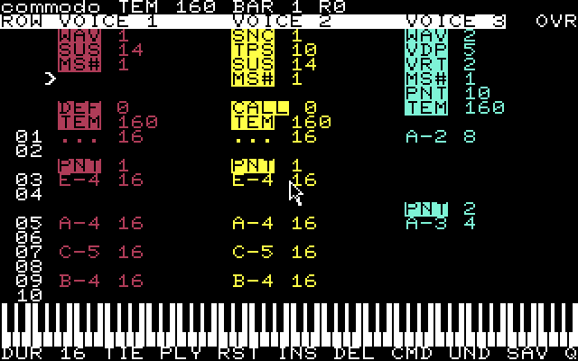
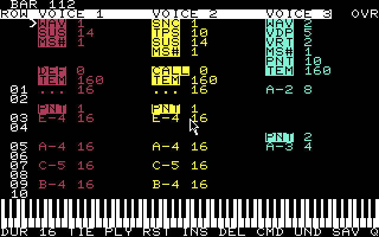
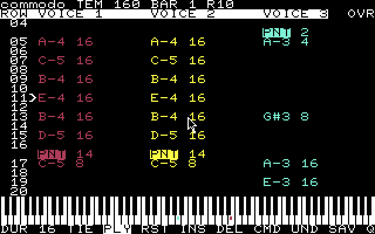
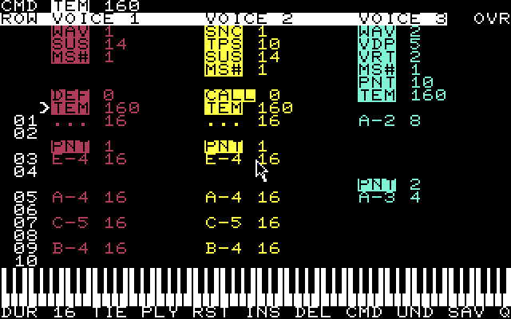
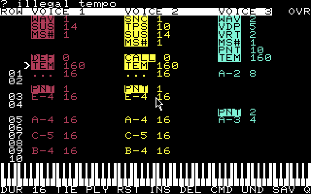

# `musedit` — writing music on GordonOS

`musedit` is GordonOS's music editor. It writes and edits COMPUTE!'s Enhanced Sidplayer
tunes — the `.mus` files that `sidplay`, `godzi`, `gortris` and `grknoid` play — and it auditions
them through the very same player those tasks use, so what you hear while you work is what will
ship.

The file is never converted. `musedit` opens the `.mus` image exactly as it is, works out when each
event plays, and draws that as a three-lane tracker grid: the tune's own time running down the
screen, the three SID voices side by side, and a piano across the bottom. Every edit is written back
as the 2-byte event pairs the format already uses, which means a tune you open and save untouched
comes back byte for byte identical, and **any** well-formed `.mus` can be opened, read and changed —
including tunes written years ago by some other editor.



## Contents

- [Before you start](#before-you-start)
- [A quick lap round the editor](#a-quick-lap-round-the-editor)
- [The screen, piece by piece](#the-screen-piece-by-piece)
- [Reading a lane](#reading-a-lane)
- [Moving around](#moving-around)
- [Entering notes](#entering-notes)
- [Editing the timeline](#editing-the-timeline)
- [Playing](#playing)
- [Commands: envelopes, waveforms, vibrato, filter and the rest](#commands-envelopes-waveforms-vibrato-filter-and-the-rest)
- [Undo and redo](#undo-and-redo)
- [Saving, quitting, and what is left behind](#saving-quitting-and-what-is-left-behind)
- [When musedit says no](#when-musedit-says-no)
- [What the `.mus` format supports, and what it does not](#what-the-mus-format-supports-and-what-it-does-not)
- [Limits you might meet](#limits-you-might-meet)

## Before you start

**You need a 1351 mouse.** A note is entered by clicking a piano key, so with no mouse in the
system there is no editor to work in: it refuses with `? no mouse - mouse 1351 first`. Run
`mouse 1351` from the shell first — it is already in `boot.bat` — and start the editor again.

Start it from the shell with a tune's name:

```
run musedit commodo
```

That opens `commodo.mus` from the REU filesystem. **The base name is at most 7 characters**; `.mus`
is appended for you. A name that does not exist starts a **new tune** — three voices holding
nothing but their `HLT`, an empty description and the usual load address — so `run musedit mysong`
is how you begin from scratch.

```
run musedit
run musedit toolongnm
```

are refused on a screen of their own with the usage line, `? name - run musedit <name>`, and a
reminder that the name is up to 7 characters. Press any key to go back to the shell.

Two things you cannot do at the same time:

- **One `musedit` at a time.** A second one answers `? already running`.
- **`sid.lib` belongs to one task.** While another task is playing (`sidplay`, `godzi`, `gortris`,
  `grknoid`) the shell refuses the launch with `? sid.lib in use`. Stop the other player first —
  `S` in `sidplay` stops the tune — and the editor starts normally.

## A quick lap round the editor

If you would rather learn by doing than by reading, this is the whole loop:

| what you want | how |
|---|---|
| hear the tune | `SPACE` (the bar's `PLY` does the same) |
| put a note in | click a cell in a lane, then click a piano key |
| change a note's pitch | click the cell, then click another key — the length stays as it was |
| make a note longer | put a rest where it should end: `I` opens a row; the note now ends there |
| turn a note into a rest | `INST/DEL` |
| remove a note and close the gap | `SHIFT`+`INST/DEL` |
| change the instrument or add vibrato | put the cursor on the note's row and press `C` |
| take the last thing back | `Z` |
| save | `SHIFT`+`S` |
| leave | `Q` |

Nothing is written to disk until you save, and everything you do can be undone, so the safe way to
learn the editor is to play.

## The screen, piece by piece

The screen is a head, a grid, a piano and a control bar. Nothing else — there are no panels to open
and no mode to be in.

```
commodo  TEM 160  BAR 1 R0                    <- row 0: the head
ROW VOICE 1     VOICE 2     VOICE 3   OVR     <- row 1: the lanes, and the entry mode
    WAV 1        WAV 1        WAV 1           <- a row's command lines: no row number,
    SUS 14       SUS 14       SUS 14              one line per depth
    TEM 160      TEM 160      TEM 160
>01 ...    16    ...    16    ...    16        <- the row's own line: numbered, and what
 02 ...    16    ...    16    ...    16           each voice plays on it
 03 A-4    16    A-4    16
[rows 21-23: the piano, eight octaves]
DUR 16 TIE PLY RST INS DEL CMD UND SAV Q      <- row 24: the control bar
```

### Row 0 — the head

`commodo  TEM 160  BAR 1 R0` is the tune's name, the **tempo in force at the cursor's row** in
decimal, and the bar and row the cursor is on. When the music is playing those last two are what
the playhead is following, so they are the fastest way to tell where you are in a long tune. When
the pointer is over a piano key, or the cursor stands on a note, the right-hand end of the row also
names that pitch — `C-4`, `C#4` — so you always know what a click will write.

The tempo figure matters more than it looks: it is the one a note entered *here* will be measured
against, so in a tune that changes tempo you can watch it change as the cursor crosses the change.

When you are in a prompt the head becomes the prompt instead — `CMD TEM 160`, `BAR 12` — and when
the editor has something to tell you, its message takes the row over for a moment. Both fade back
to the tune's name by themselves.

### Row 1 — the lanes, and OVR/INS

`ROW VOICE 1     VOICE 2     VOICE 3` names the three lanes, in the SID's own voice order. At the
right, `OVR` or `INS` says what the next note entry will do (overwrite, or insert).

That readout is also a **button**: the pointer reverses it while it is over it, and a click toggles
the mode — the `M` key by another route. Because the readout *is* the button, what it says and what
the next entry does cannot disagree.

### Rows 2–20 — the grid

Nineteen rows of time, and the only part of the screen that scrolls.

Each row is **one step** of the tempo in force there — the shortest ordinary note that tempo allows
— so a whole note (one 4/4 bar) is 8, 16, 32 or 64 rows depending on the tempo. A `TEM` part way
through a tune starts a new bar and re-scales the rows from that point on, which means the rows a
bar has can differ between one part of a tune and another. The numbers down the left are rows
counted from the bar's own first row.

A row can have **several lines**: the row's own numbered line, plus a command line above it for each
depth of command that comes into force there. A command line carries **no row number**, because it is
not a point in time — and one line carries all three voices' commands at that depth, each in its own
lane and colour, so three commands on the same row take one line, not three. See
[Reading a lane](#reading-a-lane).

### Rows 21–23 — the piano

Three rows holding **all eight octaves**, C0 to B7, on one screen. The 56 white keys share the
320-pixel width, so a key is about 5.7 pixels wide; the black keys are short bars on the boundaries,
two rows tall. The key under the pointer is highlighted, and its pitch is named on row 0.

While the music plays, a **dot per voice** sits on the key that voice is sounding — **red** for
voice 1, **yellow** for voice 2, **cyan** for voice 3 — so a chord reads at a glance and you can
tell which voice is which. Each dot comes from the pitch the grid walker recorded for the event at
the playhead, so it always agrees with the note shown in the lane. A voice that is resting has no
dot, and the dots go when the tune stops. A natural's dot sits on the white part of its key, below
the black keys; an accidental's sits up on the black key itself.

While you are editing, pointing at a key puts a dot there in the colour of the lane the cursor is
in: that is the voice a click would write to. It answers "which voice am I about to write?" — and it
moves off the key as soon as you leave it.

### Row 24 — the control bar

`DUR 16 TIE PLY RST INS DEL CMD UND SAV Q`. The labels are short so that all ten fit on one row,
and each does the work of the key it names:

| cell | what it does |
|---|---|
| `DUR` | steps the armed length on through whole, half, quarter, 8th, 16th, 32nd and 64th; the dot or triplet mark rides along, so only the class changes |
| `TIE` | arms or drops the tie, and stays reversed while it is set — the `,` key |
| `PLY` | plays and stops, and stays reversed for as long as the tune plays |
| `RST` | turns the event on the cursor's row into a rest — the `INST/DEL` key |
| `INS` | opens one row of silence in all three voices — the `I` key |
| `DEL` | removes the command on the line, else the event, and closes the gap — `SHIFT`+`INST/DEL` |
| `CMD` | authors the row's command line, the `C` key |
| `UND` | undoes the last action, the `Z` key |
| `SAV` | saves, `SHIFT`+`S` |
| `Q` | quits, and asks `? unsaved - q again` first if there are changes |

The item under the pointer shows in reverse video and goes back to plain when the pointer leaves
it, so the bar always says where the pointer is as well as what is running.

`RST`, `INS` and `DEL` are what make an editing session possible **without the keyboard**: with the
piano below for pitches and the grid for the cursor, entering notes, inserting time, changing one,
resting it, deleting it, undoing and saving all happen from the pointer alone.

## Reading a lane

A lane is one voice's stream of events, laid out against time. Between them the three lanes say
everything about the tune that the file contains.

| mark | meaning |
|---|---|
| `C-4 16` | a note starts here, and its duration is a sixteenth |
| `C-4 16.` | ...dotted; `:` is double-dotted and `*` is a triplet |
| `C-4 16. TIE` | the tie flag is set on this event, so the note carries on from the one before it instead of being struck again |
| `C-4 16  ?` | the note's onset falls between two rows, so the row it is drawn on is not where it starts |
| `... 4` | a rest starts here, lasting a quarter |
| `DEF 3` | a command, on a line of its own (see [Commands](#commands-envelopes-waveforms-vibrato-filter-and-the-rest)) |

The duration is written in the format's own numbers, on the note's own row: a whole note, a half, a
quarter, an 8th, a 16th, a 32nd and a 64th read `1`, `2`, `4`, `8`, `16`, `32`, `64`. A utility
length prints no number, because its length is whatever `UTL`/`UTV` set.

A dot or a triplet is a **mark right after that number** — the same three marks the control bar's
dot cell uses: `.` dotted, `:` double-dotted, `*` triplet. Nothing is printed for a plain note, so
`8` is an eighth and `8.` is a dotted eighth: two different lengths, so read them as two different
things. All three come from the duration byte itself (bit 5 the dot, bit 7 the triplet, or the
second dot with bit 5), which means the mark is the format's own information and not a note the
editor keeps on the side. A note whose onset did not land on a row takes no mark: its lane ends in
the `?` instead, which is the more important thing about it.

`TIE` comes straight after the duration, and it means "hold, do not restrike": the player carries
the sound through into the next event. It is the duration byte's bit 6.

A command line prints its mnemonic in reverse video and its operand plain, so the value is easy to
read, and it never fills the row-number column — a command is not a point in time, so the row's own
line below it is the numbered one. A row's **sound** commands (envelope, wave, filter and the rest)
take the lines furthest from it and its **structural** ones — `TEM` `UTL` `UTV` `HED` `DEF` `CALL`
`TAL` `HLT` `END` — the lines nearest it, so a row's control flow always sits right above the note it
governs.

Each lane is drawn in its own voice's colour — red, yellow, cyan — the same colours as that voice's
dots on the piano, so a note and the dot that follows it are one thing seen twice. The row numbers,
the lane headers and the head stay white.

The cursor marker `>` is drawn in the free cell immediately **left of the lane the cursor is in** —
column 3, 15 or 27 — so it says which voice a key will act on as well as which line you are on.

## Moving around

| action | how |
|---|---|
| place the cursor | click a cell in the grid |
| move one row | cursor up / down; at the bottom the window scrolls a line, at the top it moves back a whole page |
| move a whole page | `SHIFT`+`,` a page back, `SHIFT`+`.` a page on |
| step a bar | `SHIFT`+`N` the bar after this one, `SHIFT`+`P` the one before |
| go to a bar by number | `SHIFT`+`B`, then type it |
| change voice | cursor left / right, or click a cell in another lane |

A page on lands on the row the window's own bottom line holds, so the next page starts on a row you
were already looking at and no row is missed. A tune that ends inside the window has no page on, and
the key does nothing. A page back is the same distance counted back from the window's top row — 19
rows, the number the grid holds — and it stops at the tune's first row. Both move the window under
the cursor: the cursor keeps its line on the screen, and the row under it changes with what the
window now holds.

**While the tune is playing the cursor is the playhead**, so `CRSR-UP`/`CRSR-DOWN`, the page keys
and the bar keys are refused — the follow would drag the marker straight back. `CRSR-LEFT` and
`CRSR-RIGHT` still work, and are the useful pair while playing: they move the dots to another
voice, so you can see which note that voice is sounding. Editing does not work while the tune plays
either; stop first (`? stop first`).

### Jumping to a bar

A bar jump is **exact**, and it is counted by walking the tune rather than dividing the row number,
because a tempo change can cut a bar short: the only truthful count is the one the tune's own walk
makes as it goes.



`SHIFT`+`B` opens a prompt in row 0 showing `BAR` and the bar you are on. Digits replace the number,
`INST/DEL` backs one digit out, `RETURN` goes there, and `STOP` leaves you where you were. `SHIFT`+`N`
and `SHIFT`+`P` step a bar at a time without the prompt.

A bar the tune never reaches answers `? no such bar` and leaves the view alone. Otherwise the cursor
lands on the row's **own line** — the note line, not one of the command lines above it — with the
window following, so you arrive where the music is, ready to edit it.

## Entering notes

The piano at the bottom of the screen is how notes go in.

1. **Click a cell in the grid.** The cursor goes there and row 0 shows the row and voice.
2. **Point at a key.** Row 0 names the pitch under the pointer (`C-4`, `C#4`) and the key is
   highlighted, so a click is never a guess.
3. **Click.** With the cursor on a row where a note starts, the event's pitch becomes the key's and
   its length is kept, so nothing below it moves. A rest is the exception — it has no length worth
   keeping, so the new note takes the armed duration. Inside a longer note the note is split; past
   the last event, or in an empty voice, rests are filled in so the note lands on the cursor's row.

**A note key also moves the cursor on.** In overwrite mode (`OVR`, the default) each note you play
from the keyboard leaves the cursor on the next row, so a run of notes goes down in one pass instead
of you moving the cursor between them. It is still overwrite: a note typed on a row that already
holds one replaces it, and nothing below is pushed down. A row's **command** lines are passed over on
the way — a command takes no time, so the next note belongs on the row's own line below them — and
the window scrolls a line at a time once the cursor reaches the bottom of the band. Clicking a key on
the piano does **not** move the cursor, because a click is a deliberate "make *this* cell this
pitch".

**The pitch sounds as you point at it.** Hovering a key — or pressing a note key — plays it for a
tenth of a second, so a tune can be found by ear before anything is written; a click still just
enters the note. It is a bare sawtooth, not the instrument the tune gives that voice: it answers "is
this the note I meant", nothing more. The pitch is the one the tune would sound — the editor applies
the machine's declared speed (`speed 200` on the shipped VICE image) exactly as the player does, so
the audition and playback agree on what `C-4` is. If another task's music is running the keyboard
stays silent rather than cutting into it, and the dots stay away, because the dots on the keys
belong to whoever is playing. During our own playback a click enters nothing (`? stop first`).

A command has a line of its own above the row it belongs to, and that line holds no note: with the
cursor on a command's line a note key is refused (`? no event here`), so an entry can never rewrite
the row below the one the cursor is on. Move down to the row's own line — the one with the row
number — and the note goes in there.

The keys are narrow — about 5.7 pixels per white key — because all eight octaves share the
320-pixel width. The black keys are short bars on the boundaries: C# between C and D, D# between D
and E, F# between F and G, G# between G and A, A# between A and B. The B–C boundary has none: that
is where one octave ends and the next begins. Pointing at a key names its pitch on row 0, so even a
four-pixel black key is never a guess.

**Every pitch the format allows is on screen at once** — there is nothing to page, scroll or
transpose to reach one.

### From the computer keyboard

The piano can be played from the computer keyboard too, which is quicker once you know a tune. The
home row is the white keys — `A S D F G H J` is one octave, C to B, and `K L ;` carry on into the
next at C, D, E — while `W E T Y U O P` play the black keys between them (C#, D#, F#, G#, A#, and
the next C#, D#). The map starts at octave 4; `-` and `+` move it. A note key enters its pitch at
the cursor exactly as a click does, and the pointer still works alongside it.

### Length, dots and the tie

| key | action |
|---|---|
| `1` … `7` | duration: whole, half, quarter, 8th, 16th, 32nd, 64th |
| `8` / `9` | duration: the `UTL` / `UTV` utility length |
| `.` | cycle the dot state: none → dotted → double-dotted → triplet |
| `,` | arm or drop the tie (the bar's `TIE` cell) |
| `-` / `+` | octave for the computer-keyboard note map (0 to 7) |

The armed values show on the control bar and stay armed until you change them. The editor starts
with a plain 16th armed.

The armed duration applies to **every** note a note key writes — one entered where no note starts,
where a rest stands, inside a longer one, or over a note already there. A note already in the grid
keeps its pitch only if you leave it alone; typing a pitch re-times the event to the armed value, so
the rows below move to suit.

**Triplets** need a tempo that has a triplet table (elsewhere the entry is refused with
`? illegal duration`). **Dotted** and **double-dotted** lengths are refused when the tempo cannot
express them as whole jiffies: a dotted note needs an even base length, a double-dotted one a base
divisible by four.

**The tie** joins a note to the one after it into a single sound. It is armed with `,` or by clicking
`TIE` in the bar — both toggle the same flag, so the cell lights whichever way you armed it. It
rides the armed value the way the dots do, so it reaches every note a note key writes, including one
written into an empty row, where the length may be laid down as two tied pairs of its own. The grid
shows it as `TIE` after the duration, which is also how a tied event already in a tune reads — a
dotted, tied note reads `C-4 8. TIE` and is the duration byte's bits 6 and 5 together. A rest never
carries a tie, and entering a rest clears the bit from a note that had one.

### Utility lengths

`8` arms the **`UTL`** length and `9` the **`UTV`** length. A note entered with one of these takes
its duration from the `UTL` command (all voices) or the `UTV` command (this voice) instead of from
its own duration bits — useful for a delayed or gated voice. Both forms round-trip as ordinary
notes.

### Sharps, flats, and pitches that cross an octave

A note key enters a black key as the **sharp** of the letter below it (`C#4`) — that is how the editor
writes one. The format can spell the same pitch as a flat (`Db4`) instead; a tune that uses one is
read, shown and played correctly, but entering that note again writes it as a sharp.

A spelling that runs past the end of its octave is shown as the note it sounds, because that is what
the player makes of it: a note stored as a B sharp reads as the next octave's C, and one stored as a
flat C reads as the B of the octave below.

### When a note does not land on a row

A triplet or a double-dotted note can be shorter than one step, so its onset falls between two rows.
Such an onset is drawn on the row it falls in, with `?` at the right edge.

`SHIFT`+`U` refines the grid until every onset has a row of its own: a half, a third, or a single
jiffy per row, taking only the steps that divide the tempo's own unit exactly — a tempo whose unit
is 9 jiffies offers three (16, 48 and 144 rows to the bar), because 9 does not halve. Each press goes
one step **finer** and, past the finest, wraps back round to the plain grid, so the states cycle
rather than stop. A tune that contains a triplet is already refined at the third when it opens,
which means the first press takes you to the finest and the second wraps to plain. Where a later
tempo cannot divide the chosen refinement, that part of the tune keeps the plain grid rather than a
broken one.

Like every other edit it needs the music stopped: the grid is drawn in the unit that was in force
when it was painted, so refining it mid-pass would leave the rows and the playhead apart. It answers
`? stop first`.

## Editing the timeline

The grid is time, and a note's length is the distance to the next note or rest in its voice. That one
fact explains everything the editor does when you enter a note:

- **Entering on a note** replaces it. The rows below do not move.
- **Entering on a rest** replaces it and takes the armed duration, so the rows below come up by the
  difference.
- **Entering inside a longer event** splits it: the rows above your note keep the event's pitch, the
  new note takes the armed duration and lands on the row you clicked, and what the event had left
  keeps that pitch again behind the note. A part that is not one legal length is written as several
  tied events. The three runs together last exactly as long as the event did, so the rest of the tune
  does not shift.
- **Entering where no duration reaches** fills the gap with rests first. Rests are ordinary events;
  you will see `...` where they were inserted.
- **Entering past the end of a voice** fills up to the cursor and inserts before the `HLT`.

To change a note's length you do not edit the note — **you move the next event**. Insert a note or a
rest at the row where the note should end and the length follows. That is how the format itself
works, and it is why the grid never shows overlaps.

| key | action |
|---|---|
| `INST/DEL` | replace the note at the cursor with a **rest** of the same length |
| `SHIFT`+`INST/DEL` | **delete** the event and close the gap; on a command line it removes that command |
| `I` | **insert a row** at the cursor, pushing everything below down |
| `SHIFT`+`I` | **insert a bar** (the rows a bar has at the tempo in force where the cursor is) |
| `R` | **delete a row** at the cursor, in all three voices |
| `SHIFT`+`R` | **delete a bar** — the same rows `SHIFT`+`I` would open |
| `M` | **insert/overwrite mode** for entering notes (the `OVR`/`INS` readout) |
| `C` | **write or edit the command** at the cursor |
| `SHIFT`+`D` | **follow a phrase**: from a `CALL` to its `DEF`, from a `DEF` to the next `CALL` |
| `Z` / `X` | undo / redo |

The `HLT` that ends a voice cannot be deleted; it can be pushed down by inserting before it.

### Inserting time

Everything you enter goes **on** the grid as it is. When you need more room — to put a note where
another one already sits, or to open a bar in the middle of a tune — insert instead:

- **`I` opens one row.** Everything below the cursor moves down one row, in **all three voices**, so
  the voices stay lined up. A note that is already sounding is cut on the cursor's row; it resumes
  on the same pitch after the gap with a fresh attack.
- **`SHIFT`+`I` opens a whole bar** — 8, 16, 32 or 64 rows, whichever a bar is at the tempo in force
  where the cursor is. A tune that changes tempo has bars of different lengths, and the bar inserted
  is the one that fits the part you are in, so every bar number before it is unchanged.
- **`M` switches note entry to insert** — as does a click on the `OVR`/`INS` readout. With `INS`
  showing, entering a note writes it **after** the event the cursor's line holds, opening that
  note's length in **that voice only** so its later events move down, and the cursor follows the new
  note. The other two lanes keep exactly the events they had, so a voice you have not written to yet
  stays empty. Entering notes one after another therefore builds the tune forward, in the order you
  play them. `M` again returns to `OVR`, where entering a note replaces or splits.

Inserting **time** — `I`, `SHIFT`+`I`, `INS` — is the operation that touches all three voices: the
three lanes are one timeline, so opening rows in one lane alone would slide it against the others
with nothing to line it up again. Inserting a **note** in `INS` mode is that voice's own edit and
leaves the other two untouched.

The mode is only about the *next* note: switching it changes nothing in the file.

### Deleting time

Deleting is the same operation backwards: **`R` closes one row** at the cursor and **`SHIFT`+`R`** the
whole bar there, in all three voices, so the lanes stay lined up. A voice with nothing sounding on
the row is left alone — there is nothing there to close.

An event that runs **past** the row is refused instead, and the message names the voice —
`? a note in voice 2 spans the row`. A row boundary in the middle of a note is not a row to remove,
because closing it could only make that note shorter. Shorten the note first (a rest on the row
where it should end) and delete again. A row or a bar goes in one `Z`, however many events it took
out.

### Phrase bodies

A `DEF` body is not a separate region of the grid: it plays **inline**, where the definition stands,
so each of its rows is drawn once, in order, with the `DEF` on the command line above the first of
them. A `CALL` elsewhere plays the same body again at the call site, which is what makes phrases
worth having — and it is why editing a body is editing **every** place that plays it.

The editor tells you when the cursor is on one: the status line says **`phrase 3 x5`** — the phrase
number, and how many `CALL` sites play it, counted across all three voices (a body is global, so any
voice's `CALL` can play it). It says so again each time a note is entered there, because that is the
moment the change reaches every call site.

Moving **time** in or out of a body is refused instead: the rows below would shift inside the body,
so the phrase would come back longer or shorter everywhere it is played. Inserting and
`SHIFT`+`INST/DEL` therefore answer `? phrase 3 x5` there and write nothing. Changing a pitch, a
command or a duration affects every call site too, and is allowed — that is how you change a phrase
everywhere at once.

### Following a `CALL` to its `DEF`

The command lines above a row are the tune's own control flow: a `CALL` plays a phrase whose `DEF`
sits somewhere else in the same voice, and a big tune like `immig` has sixty-five of them, so
reading one half of a pair means finding the other.

Put the cursor on a command line and press **`SHIFT`+`D`**:

- on a **`CALL`** it moves the cursor to that phrase's **`DEF`** — the line carrying the definition,
  not the row's own numbered line;
- on a **`DEF`** it moves to the **next `CALL` of that phrase below the cursor**, and once there is
  none below it wraps round to the first one in the tune — so pressing it again and again tours the
  call sites.

The window follows: the found row becomes the top of the grid, the line carrying the command is
brought into the band, and the head's `BAR`/`R` show where you are. Anything else on the line — an
`ATK`, a `TEM`, or a row's own numbered line — answers `? not a phrase` and moves nothing.

**`SHIFT`+`D` acts on the lane the cursor is in.** A line carries one command per lane, so the lane
decides which one is followed — and the `>` marker in the gap left of the lane tells you which lane
that is. If the lane has no command on that line the key answers `? not a phrase`: move the cursor
left or right into the lane that shows the command.

### Illegality is caught where it happens

A duration the current tempo cannot express is refused with `? illegal duration`, and nothing is
written. The classic case is a 32nd or 64th at a moderate tempo, or a triplet at a tempo that has no
triplet table. Choose a longer value, or change the tempo first.

One corner a foreign file can carry: a note pair whose duration byte is exactly `$00`. The format
does not say what such a pair means — the reference notes that only the player decides — and the
player plays it as a 64th note, so the grid draws it as one and writes it back unchanged.

## Playing

`SPACE` (or `PLY` on the control bar) starts the tune **from the row the cursor is on**, and stops it
again. The tune plays through `sid.lib`, the same player `sidplay` uses, so what you hear is what
will ship.



The **cursor is the playhead**: while the music plays it moves down the grid with it, the window
scrolls a line at a time to keep it on the middle row, and the head spells out that row's bar and
row. It shows the **call site** while a phrase is playing rather than the phrase body. When you stop,
the cursor stays where the music stopped — that is where editing resumes, and the next `SPACE`
carries on from there rather than starting over.

**Starting part way through is silent, and it takes a moment.** The format has no seek: a voice is a
stream of events, so the player reaches a row only by playing everything before it. `SPACE`
therefore runs the pass from the first row with the volume masked, at full speed and without sound,
until the music reaches the cursor's row. Every command takes effect on the way — waveform, pulse,
ADSR, filter, tempo and the transposes are the tune's own at that point — which is what makes a
start mid-tune sound like the tune. The score holds the cursor's row while this happens, so it does
not scroll away and back, and the length of the wait is the music's own elapsed time at that row:
about a second for the first screenful, a few seconds for a row an ordinary tune reaches in the
middle, and the tune's whole length for its last row. `SPACE` at row 1 costs nothing at all.

What it cannot reproduce is the SID's own envelope: a note already sounding when the sound comes up
is caught earlier in its envelope than a pass played in real time would leave it, so it may sound a
little different for a moment. Everything the tune itself sets is exact.

The player publishes the number of jiffies it has played in this pass, and a grid row is a fixed
number of jiffies at the tempo in force, so the cursor's row is that count divided by the row's
length. Nothing is predicted between events and nothing is re-anchored: a note that lasts 128 rows
simply stays on each row for its share of the count. A scroll down redraws only the newly
revealed bottom line — the rows above are moved by the kernel's REU screen scroll. Scrolling up moves the window back a whole band, because the line above the
window has not been walked yet. Either way the window remembers *which of a row's lines* it is
standing on, not just the row: a repaint for an edit, an undo or a change of row unit puts the score
back exactly as it was, and the cursor's row is read from the same map the screen was drawn from.

The tune **loops only if it says so**: a section is a `HED` and the `TAL` that closes back to it, and
the player honours that inside a pass, so a tune written to repeat repeats by itself and one with no
section ends at its last row, where the music stops and the score rewinds to the beginning, cursor
and all, ready for the next `SPACE`. While a section loops the score keeps **counting up**: the walk
executes the same `HED`/`TAL`, so each time round is walked as later rows with later clocks rather
than jumping back to the section's first row. The cursor keeps following the music, and the row
numbers keep climbing, with the bar number climbing with them.

Only one player can own the SID. If the chip is taken **while** you are editing (a task loaded from
the shell, say), `SPACE` reports `? no player` for a moment and play stays unavailable until
`musedit` is restarted; the same message appears if `sid.lib` cannot be loaded because the pool is
full. Editing carries on either way.

## Commands: envelopes, waveforms, vibrato, filter and the rest

Commands are the sound of the tune: everything a note is played *with*, and everything that changes
as the music goes along. A `.mus` command is a 2-byte event placed **before** the note it affects,
and it stays in force until something changes it.

`musedit` groups them by the note they belong to: every command that comes into force at a note's
onset gets **a line of its own above that note's row**, and the cursor passes over those lines on its
way down. A command pair takes no time of its own — it comes into force at the onset of the next note
or rest, which is why a command line only ever sits above a note or a rest. There is no place
"inside" a duration to put one, and the editor refuses a row in the middle of a note rather than
splitting it.

### Writing a command line

Put the cursor on a **note's own row** and press `C` (or click `CMD` on the control bar). The head
row becomes the prompt:



| key | in the prompt |
|---|---|
| CRSR up / down | choose any of the 49 commands the picker offers, in the format's own order |
| `RETURN` | take it, then finish its value — or write it straight away for `TAL`, `HLT`, `END` |
| digits | build the value in decimal, never past what that command takes |
| `INST/DEL` | back one digit out |
| `STOP` | cancel, and the grid comes back as it was |

The list runs from the tune's own settings — `TEM` `UTL` `UTV` `HED` `DEF` `CALL` `TAL` `HLT` `END` —
through every sound command the format defines, ending with `MS#`, `FLG` and `AUX`. The pair is
written at the boundary the cursor's row starts, so every row stays where it is and nothing needs
renumbering.

**Values.** The prompt takes the value in decimal, up to whatever that command allows: most take
0–255, the one-bit commands (`SNC`, `FLT`, `RNG`, `3-O`, `BMP`, `F-X`, `LFO`, `P&V`) take 0 or 1,
`WAV` and `F-M` 0–7, the envelope nibbles 0–15, `RUP`/`RDN` 0–31, and three take more than a byte —
`MS#` up to 999, `P-W` and `DTN` up to 4095, `POR` up to 16383. A value the command cannot hold is
clamped to its maximum rather than refused, so what the prompt shows is always what gets written.

**Writing `TEM` is the one that catches people out.** The first `RETURN` chooses the mnemonic and the
second writes the value: the head shows you where you are, and once you have taken the mnemonic the
digits you type build the number that will be written. If the number you write makes the tune
unplayable, the editor says so and puts everything back — see below.

**Overwrite or insert** — the mode `M` shows decides what happens when that boundary already carries
the same command: `OVR` replaces it where it stands, `INS` adds a second pair.

**Editing and removing** — put the cursor on an existing command line and `C` opens the prompt *on
that line*, already filled in and ready to change; `SHIFT`+`INST/DEL` removes that pair and closes
the gap. `Z` takes either back, like any other edit.

### A written pair the tune cannot play is refused, and taken straight back

After writing, the editor walks what it wrote — it has to, because a command can make the rest of the
tune unreadable without touching the row you edited. If that walk stops, the edit is undone on the
spot, the redo is withdrawn, and row 0 says which:



- `? illegal tempo` — the tempo now leaves some note length inexpressible (the classic case: a 16th
  at a tempo whose unit is coarser than one).
- `? the tune cannot play that` — anything else the walk tripped over: a `CALL` to a phrase with no
  `DEF`, a call stack one frame too deep, a `TAL` whose `HED` belongs to another phrase.

Either way the grid comes back exactly as it was, and **there is nothing left to undo** — a value
that cannot work never costs you a `Z`. You do not have to remember to undo it, and you cannot
accidentally save it.

A file that was **already** unwalkable when you opened it keeps that state: the refusal only fires
for a pair that the write itself broke, so a damaged or foreign file can still be opened, inspected
and edited.

### One command per lane

**A line carries one command per lane, and `C` acts on the lane the cursor is in.** Aim at the lane
that shows the command you mean — the one you last moved into with `CRSR-LEFT`/`CRSR-RIGHT`, or the
one the click landed in. On a line whose lanes have nothing for the cursor's voice the editor answers
`? no command in this lane` rather than opening an empty prompt.

That matters most for the settings a whole tune shares — the tempo above all. The player keeps
**one** tempo, but each voice's stream sets it with its own `TEM` pair, so a tune normally carries
the same `TEM` in every voice, and the value in force is whichever pair that row's walk reaches last.
Change one lane's copy and the others still stand, so change the `TEM` line in each voice that shows
one. The same goes for `UTL`, and for any command a tune repeats per voice.

### Tempo is a point in the tune, not a property of the file

A `TEM` at any row takes effect **there** and holds until the next one, so a tune can change tempo as
often as you like, and the tempo is not something you set once at the top.

What the grid does about it: from the row a `TEM` sits on, the rows are the new tempo's own step and
a bar is one whole note counted in those rows, so **a bar's row count can change at a change** — a
tune at tempo 144 (16 rows to the bar) that moves to 192 has 64 rows to the bar from there on. A
change that lands between bar lines cuts that bar short; a change on a bar line starts the next one.
The head's tempo figure, `SHIFT`+`I`'s "one bar" and the duration checks all follow the row the
cursor is on rather than the tune's opening tempo.

`TEM` is one register in the player, so two voices that set different tempos on the **same row** do
not run at two tempos: each lane's own note is measured with the value that lane set, and from the
next row the tempo is the **last** of them (voice 3's, since the player processes the voices in
order). Rows that become illegal because of a tempo change are flagged on the grid rather than
silently kept.

### The groups

`TEMPO` `VOLUME` `REPEAT` `PHRASE` `ENVELOPE` `WAVE` `FREQ` `FILTER` `MOD` `MISC`

### Command reference

| group | name | value | what it does |
|---|---|---|---|
| TEMPO | `UTL` | 0-255 | length, in jiffies, of a note with the UTL duration |
| | `TEM` | tempo value | sets the tempo (the classic table: `$90` ≈ 100, `$A0` ≈ 90, `$F0` ≈ 60) |
| VOLUME | `VOL` | 0-15 | master volume |
| | `BMP` | up / down | volume ±1, or down a whole group |
| REPEAT | `HED` | 0-255 | start of a repeat section; the operand is how many times the section plays **in total**, and 0 means forever |
| | `TAL` | — | end of the section: jump back, or fall through when the count runs out |
| PHRASE | `CALL` | 0-23 | play a phrase definition |
| | `DEF` | 0-23 | define a phrase; the body follows and plays inline |
| | `END` | — | end of a phrase body |
| ENVELOPE | `ATK` `DCY` `SUS` `REL` | 0-15 | the ADSR nibbles |
| | `PNT` | 0-255 | release point: when in the note the release phase starts |
| | `HLD` | 0-255 | hold time before the release point is honoured |
| WAVE | `WAV` | 0-7 | waveform: 0 noise, 1 triangle, 2 sawtooth, 3 tri+saw, 4 pulse, 5 tri+pulse, 6 saw+pulse, 7 all three |
| | `P-W` | 0-4095 | pulse width |
| | `P-S` | -128…127 | pulse-width sweep, added every jiffy |
| | `PVD` | 0-127 | pulse-width vibrato depth |
| | `PVR` | 0-127 | pulse-width vibrato rate |
| | `SNC` | on / off | oscillator sync |
| | `RNG` | on / off | ring modulation |
| FREQ | `VDP` | 0-127 | vibrato depth |
| | `VRT` | 0-127 | vibrato rate |
| | `POR` | 0-16383 | portamento: slide into the next note |
| | `P&V` | on / off | portamento and vibrato together |
| | `DTN` | -2048…2047 | detune, in the player's frequency units |
| | `TPS` | -95…95 | transpose every later note, in semitones |
| | `RTP` | -47…47 | transpose relative to the previous note |
| FILTER | `F-M` | 0-7 | filter mode: 1 low-pass, 2 band-pass, 4 high-pass, combinable |
| | `F-C` | 0-255 | filter cutoff |
| | `F-S` | -128…127 | cutoff sweep, added every jiffy |
| | `AUT` | -128…127 | cutoff follows the note's pitch |
| | `RES` | 0-15 | resonance |
| | `FLT` | on / off | route this voice through the filter |
| | `F-X` | on / off | route the external input through the filter |
| MOD | `LFO` | tri / pulse | software LFO shape |
| | `RUP` `RDN` | 0-31 | LFO rate up / down |
| | `SRC` | 0-2 | modulation source: software LFO, oscillator 3, envelope 3 |
| | `DST` | 0-3 | destination: off, frequency, pulse width, cutoff |
| | `SCA` | -7…7 | modulation scale |
| | `MAX` | 0-255 | modulation maximum |
| MISC | `MS#` | 0-999 | measure number, written by the player and shown on its own line |
| | `UTV` | 0-255 | this voice's utility length (see *Utility lengths*) |
| | `FLG` | 0-255 | sets the player's flag byte — **no effect in GordonOS** |
| | `AUX` | 0-255 | reserved — **no effect** (the player's hook cannot be reached) |
| | `3-O` | on / off | switch voice 3 off (it is then free for sound effects) |
| | `HLT` | — | stop this voice |

`JIF` is the one command in the format that the picker does not offer and the grid never draws. It
would rescale the jiffy, and the player's jiffy is the scheduler tick, which a task cannot reload; it
is decoded, its operand is consumed, and nothing follows from it. A `JIF` already in a tune is kept
in the file untouched. `AUX` and `FLG` are offered, written and kept for the same reason — see
[Commands that are kept but do nothing here](#commands-that-are-kept-but-do-nothing-here).

## Undo and redo

`Z` undoes the last action and `X` redoes it. One action is one thing you did — entering a note that
split a longer one undoes as a single step, not one per event it wrote. A long run of recent actions
is held; opening a tune resets the history.

The history lives in a 2 KB file called `musedit.und`, made when the editor opens and **deleted when
you quit**, so a session leaves nothing behind. It costs the same space however much you edit, and
`compact` is what returns the directory slot to the filesystem.

## Saving, quitting, and what is left behind

`SHIFT`+`S` (or `SAV` on the control bar) saves to the same name. If the tune has grown beyond the
room the file was given, the editor recreates the file with room to spare; otherwise it writes in
place. A failed save reports `? no space` or `? dir full` and leaves the old file untouched. A save
**while the tune is playing** is refused with `? stop first`: the player and the save both set the
transfer registers up around their own REU work, so overlapping them could corrupt one of the two.

The description that ships inside the file — the text `sidplay` can print — is preserved exactly,
including any bytes after its terminator. It is not editable; see
[What the `.mus` format supports](#what-the-mus-format-supports-and-what-it-does-not).

`Q` quits. It does not quit **while the tune is playing** (`? stop first`: the player would be pulled
out from under the music, so every action that must not run during a pass says the same). Nor does it
quit with unsaved changes: the status line warns with `? unsaved - q again`, and you either
`SHIFT`+`S` to save or `Q` again to discard them.

While you edit, the tune you are working on lives in a scratch copy called `<name>.wrk`; the
`<name>.mus` itself is only touched by a save. The scratch is removed when you quit, so it does not
clutter `dir` — and because a deletion only tombstones a file's space, the REU filesystem gives that
space back when you run `compact`.

## When musedit says no

Every message the editor can print, and what to do about it:

| message | meaning |
|---|---|
| `? name - run musedit <name>` | no name given, or the base name is too long (`up to 7 characters` on the next line) |
| `? already running` | another `musedit` is resident |
| `? sid.lib in use` | another task has `sid.lib` loaded (a player is running) — printed by the shell before `musedit` starts; stop the player first |
| `? no space` | the pool cannot hold the tune's new size; nothing was changed |
| `? no windows` | the pool could not seat the three read windows, and the grid cannot be read without them — nothing was opened |
| `? no player` | the SID was taken by another task during playback, or `sid.lib` could not load |
| `? stop first` | an edit, a save, a jump or a quit was attempted during playback |
| `? illegal duration` | the current tempo cannot express that note length |
| `? illegal tempo` | a command write left a length the tempo cannot express; the editor **took the pair straight back** — the tune is exactly as it was, with nothing to undo |
| `? the tune cannot play that` | a written command left the tune unwalkable in some other way — a `CALL` to a phrase with no `DEF`, a call stack one frame too deep, a `TAL` whose `HED` is in another phrase. The pair was taken straight back |
| `? no event here` | the rest or delete key needs the cursor on a row where an event starts |
| `? a note in voice 2 spans the row` | `R` or `SHIFT`+`R` met a note that runs past that row, so the row cannot be closed without shortening it — shorten the note first, then delete |
| `? hlt ends the voice` | `SHIFT`+`INST/DEL` on an `HLT` line: that pair is what ends the voice, so removing it would leave the voice unreadable — delete the events above it instead, or retype the line |
| `? phrase 3 x5` | an insert or a delete was attempted on a row inside phrase 3's `DEF` body, which 5 `CALL` sites play — move off it, or edit the phrase deliberately with a note |
| `? nothing to undo` | `Z` with no action behind it — a freshly opened tune, or everything already undone |
| `? nothing to redo` | `X` with nothing undone since the last edit |
| `? no definition` | `SHIFT`+`D` on a `CALL 3` line when the tune has no `DEF 3` at all |
| `? no call` | `SHIFT`+`D` on a `DEF 3` line that no `CALL` in the tune plays |
| `? no command in this lane` | `C` on a command line, in a lane that has no command on it — a line carries one command per voice, so the cursor must be in the lane that shows the one to change |
| `? no such bar` | a bar jump asked for a bar the tune never reaches — the tune's own walk counts the bars, so the last bar is the last one it opens |
| `? not a phrase` | `SHIFT`+`D` on a line with no `CALL` or `DEF` in the cursor's lane — move into the lane that shows one |
| `? no pointer art` | the mouse is on but the pointer sprites could not be resolved — the REU image is stale |
| `? no mouse - mouse 1351 first` | the system has no 1351: run `mouse 1351` from the shell, then start the editor again |
| `? no fs` | the REU image has no filesystem signature — the shipped image always has one, so this is another build or a wiped image: put the shipped image back |
| `? no scratch` | the scratch copy `<name>.wrk` could not be opened or made — it is 255 pages, 65,280 bytes, so the REU filesystem needs that much free — or the tune is larger than it can hold |
| `? dir full` | the REU filesystem's directory has no free record for a new file — delete a file you no longer need, then save again |
| `? write failed` | the REU filesystem refused a transfer: a save failed part way (the working file still holds the image, so save again), or a page of the working copy could not be moved, which means the edit on screen may not be in the file — save soon and check the result |
| `? not a valid .mus file` | the file is either too short to hold a tune header, or one of its voices does not end on its `01 4F` terminator — a stream of two-byte commands that ends anywhere else has lost or gained a byte, so every pair after that point would read as a command the tune never wrote |
| `? saved` | the tune was written — a report, not a refusal |
| `? unsaved - q again` | `Q` with edits that are not saved: `SHIFT`+`S` saves them, or `Q` again quits and discards them |

## What the `.mus` format supports, and what it does not

`musedit` is only ever as capable as the file it edits, so it is worth knowing what a `.mus` file
*is*. Knowing this is what turns a refusal from a mystery into an answer.

### The shape of the file

A `.mus` file is a PRG, and it is almost all command stream:

| bytes | what |
|---|---|
| 0–1 | load address (ignored by every editor and player) |
| 2–7 | the byte length of each of the three voice streams |
| then | voice 1, voice 2, voice 3 |
| then | the song description, NUL-terminated |

Each voice is a stream of **2-byte pairs**, and every voice must end with `01 4F` — the `HLT` that
stops it. A pair is either a **note** (the command byte's low two bits are zero) or a **command**.
The bits are interleaved across the two bytes rather than split cleanly into "command" and "value":
`POR` is 2 bits of command and 14 bits of value, taken from both bytes, and a note's duration byte
carries the length, the dot, the tie and the triplet flag.

That is the whole file. There are no instrument definitions, no pattern table, no timing map, no
names, no comments — **only the pairs and a line of description text**.

### Three voices, one clock

Everything the format describes happens on a timeline shared by the three voices: a pair's duration
is the gap to the next pair *in its own voice*, and the player advances all three together. Three
consequences follow, and each of them explains something the editor does:

- **A voice is monophonic.** One pitch at a time: a chord is three voices, or nothing.
- **There are no overlaps.** A note ends where the next event in its voice starts, which is why the
  editor lengthens a note by moving the next event rather than by editing its length.
- **There is no seek.** Nothing in the file says "from here, the tune sounds like this", so reaching
  a row means playing the ones before it. That is the silent fast-forward in
  [Playing](#playing), and it is a property of the format, not a shortcut the editor did not take.

### Everything you can tell the player

The format's commands group in eights by the command byte, and the picker lists them in that order.
If you know what you want musically, this is the map:

| you want | what to use |
|---|---|
| a different instrument | `ATK` `DCY` `SUS` `REL`, then `WAV` and `P-W` |
| vibrato | `VDP` `VRT`, or `PVD` `PVR` for the pulse width |
| a sweep that moves by itself | `P-S` (pulse width) and `F-S` (cutoff), added every jiffy |
| a filter that follows the note | `AUT`, with `F-C` `RES` `F-M` `FLT` |
| a slide into the next note | `POR`, or `P&V` to keep the vibrato too |
| transpose a passage | `TPS` (absolute) or `RTP` (relative to the previous note) |
| detune | `DTN` |
| cycling modulation | `LFO` `RUP` `RDN` `SRC` `DST` `SCA` `MAX` |
| repeat a section | `HED` … `TAL` |
| reuse a passage without copying it | `DEF` … `END`, played by `CALL` |
| a delayed or gated voice | `UTL` / `UTV` with the utility note lengths |
| a sound effect on voice 3 | `3-O` frees voice 3 while the tune runs |

### Commands that are kept but do nothing here

Three commands are present, writable and preserved, and have no effect in the GordonOS player:

- **`JIF`** — "jiffy clock adjust". The player's jiffy is the **scheduler tick**; a task cannot
  reload it, so the pair is decoded, its operand consumed, and nothing follows. It is also the one
  command the picker does not offer, because its value is not the operand alone but the operand times
  four plus the top two bits of the command byte: a 10-bit signed number that the grid's small
  decimal fields cannot draw truthfully. A `JIF` already in a tune is kept and written back
  untouched.
- **`AUX`** — calls a function pointer that lives inside `sid.lib`'s own data, where no task can
  install a routine. It is offered and written so that a tune made for the original player can be
  opened, inspected and re-saved without losing it.
- **`FLG`** — sets the player's flag byte. In the original it was how a tune asked the *editor's*
  screen to print the next line of a `.wds` words file; this player has no screen and no `.wds`
  support, and nothing reads the flag, so the value is decoded and dropped. It is written like any
  other command, so a tune that carries one keeps it.

### What the format has no room for

These are things other trackers do and this format simply cannot express, so `musedit` does not
pretend to:

- **Per-frame instrument tables.** No pattern-programmed waveform, pulse or filter sequences: a
  command is a single value in force until the next one. The nearest equivalents are the sweeps
  (`P-S`, `F-S`) and the software LFO (`LFO` … `MAX`).
- **Hard restart** — forcing the envelope to zero before a note's gate opens, so the attack does not
  click. It is not a command.
- **Multispeed**, and **per-voice tempo.** There is one clock, so "this voice runs twice as fast" has
  nowhere to live.
- **Lyrics or `.wds` words**, printing, playlists.

### What editing is refused, and why

`musedit` refuses a few edits, and each refusal protects the file rather than the editor:

| refusal | why |
|---|---|
| a duration the tempo cannot express (`? illegal duration`) | the format stores a length *class*, not a jiffy count, so a length the tempo's table has no entry for would be written as some other length |
| a pair that leaves the tune unwalkable (`? illegal tempo`, `? the tune cannot play that`) | a `CALL`, `TAL` or tempo can break the *rest* of the tune; the walk finds it and the pair is taken back |
| inserting or deleting time inside a `DEF` body (`? phrase 3 x5`) | the body plays at every `CALL` site, so the row count change would land in all of them |
| deleting a row through a note (`? a note in voice 2 spans the row`) | closing the row could only shorten the note, and the format has no way to say "the same note, one row shorter" |
| removing an `HLT` (`? hlt ends the voice`) | that pair is what ends the voice; without it the stream runs on into the next voice's bytes |
| any edit during playback (`? stop first`) | the grid is drawn from the walk the player is running, so the two would part company |

### What `musedit` does not offer

Deliberately, because the file is fully readable and editable without them: a raw event view, a
sections or patterns view, block copy and paste, instrument macros, jam recording, mute and solo, and
description editing. Each would be another screen to learn, and none of them can express anything the
commands above cannot.

## Limits you might meet

Two numbers bound what you can build, and neither is in the file:

- **A tune can grow to about 65 KB.** The editor works on a 65,280-byte scratch copy of the tune in
  the REU filesystem, and a fresh one takes that room when the tune is first opened, whatever the
  tune's size. That is fourteen times the largest bundled tune, so it is not a limit you will meet by
  writing, and the space comes back on `compact` once you stop editing. `? no space` means that cap,
  not the pool.
- **A voice must end on its `01 4F` terminator.** A `.mus` whose voice ends anywhere else has lost or
  gained a byte and cannot be read as the format says, so the editor refuses it at open with
  `? not a valid .mus file` rather than draw commands the tune never wrote. All the bundled tunes are
  well formed; a file that is not is damaged or came from something else.

And the format's own ceilings, which you will meet long after the two above:

- **24 phrases** (`CALL`/`DEF` 0–23), each with a fixed-size per-voice call stack, so nesting has a
  ceiling and a call one frame too deep is refused.
- **`MS#` up to 999** — four values of the command byte's high bits.
- **A 7-character tune name**, because the editor appends `.mus` (or `.wrk`) to it and the REU
  filesystem's names stop at 11 characters.


